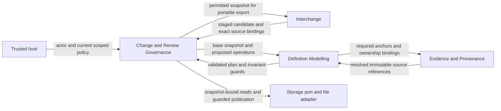

# KnowledgeHub domain analysis

Draft 0.3 · Updated 31 October 2026 · Full ontology/self-model evidence exists; shared storage and generic indexed-neighbour/query refinements are proposed. Domain boundaries and practitioner acceptance remain under review.

This document owns the working domain vocabulary, responsibility boundaries and invariant catalogue for the `knowledgehub` library. The [ontology proposal](../source/system-definition-ontology-proposal.md) supplies the requirements and target ontology. The [Practical Design Manual](../source/practical-design-manual.md) supplies the design method. Its Memento examples are examples, not KnowledgeHub requirements.

Read this analysis first, then the [slice plan](../delivery/slice-plan.md), then the [self-hosting plan](self-hosting-plan.md). The user's direction establishes the workflow: domain analysis → outcome slices → behavioural specifications → authorised implementation → progressive use of KnowledgeHub for its own definition. The particular boundaries and cuts below are proposals for review.

## 1. Situation and outcome

The concrete starting situation is this repository: an ontology proposal, a practical design manual, OpenSpec tooling and an unchanged Cargo starter. A maintainer must turn the proposal into a coherent library while preserving the meaning of its sources, design choices and verification obligations.

The desired outcome is that an authorised maintainer can establish what a definition means, inspect its exact source, change it coherently, understand its consequences, review a specific revision and recover the same explanation after restart or transfer. KnowledgeHub will progressively retain this project's own model through those same operations.

The repository is evidence of the starting material, not user-research evidence. Pain points such as conflicting definitions and lost rationale are design risks identified by the proposal. Their frequency and user benefit have not been measured. No numerical improvement target is asserted.

| Participant | Responsibility and useful outcome |
| --- | --- |
| Model author / library maintainer | Proposes definitions and relationships with explicit sources and ownership. |
| Reviewer / product decision owner | Assesses exact scopes and resolves meaning; the user currently holds the adoption decision. |
| Host application / authorised integration | Calls the embedded Rust API with current actor and policy context. |
| Returning reader / consuming tool | Retrieves permitted, snapshot-consistent definitions, history and provenance. |
| Library implementer | Supplies the mechanisms and verification evidence for the specified contracts. |

An AI-assisted tool can propose content through the host's permitted operations. Generated text and a modelled role do not grant runtime authority. There is no requirement for an AI subsystem or a dedicated UI in the first library.

## 2. Keep the three modelling levels explicit

| Level | KnowledgeHub example | Consequence |
| --- | --- | --- |
| Ontology | Types such as `Requirement`, `UseCase`, `AggregateDefinition` and a permitted `satisfies` relationship. | Defines which records and assertions can be valid. |
| Definition of this library | The Commit Change Set use case and the aggregate definition describing a model branch. | These describe the library; a stored aggregate definition is not a live Rust aggregate. |
| Execution and evidence | A committed change set, a test run against a build, or an actual review of a selected revision. | Records an occurrence or assessment with exact scope and provenance. |

The ontology's DDD, experience, UI and delivery types are modelling families available to a described system. They do not automatically become bounded contexts, executable services or UI screens inside this library. Likewise, domain events can be represented without choosing an event-sourced implementation.

Self-description stops at these useful levels. The first implementation needs a versioned, explicitly supplied ontology/profile definition to validate its first model. It does not require an infinitely recursive model to approve its own bootstrap rules.

## 3. Ubiquitous language

| Term | Working meaning | Distinction that matters |
| --- | --- | --- |
| Hub | Governed repository containing model scopes and policy references. | Neither a production transaction store nor a source-code repository. |
| System model | Coherent definition of a particular system with scope and owner. | The KnowledgeHub library is one system that can be described. |
| Ontology / profile | Versioned vocabulary, permitted relationships, constraints and selected completeness obligations. | Type availability differs from completeness for a purpose. |
| Ontology conformance | A record/graph conforms to its exact registered property, endpoint and constraint definitions. | A familiar type name or arbitrary property bag does not establish support. |
| Kernel subject | An addressable native identity, exact revision, assertion, anchor or representation binding. | A relationship targeting an assertion or revision must not require a duplicate editable element. |
| Model completeness | Applicable obligations are met for a declared purpose and exact selection, with explicit draft gaps/inapplicability. | A complete self-model does not prove support for unused ontology families or human acceptance. |
| Element identity | Stable semantic identity within a declared namespace and scope. | A filename, label or position is not its identity. |
| Element revision | Immutable definition of that identity at a particular version. | Editing creates a successor; it does not rewrite cited history. |
| Relationship assertion | Identified, versioned claim of a typed relation between exact endpoints. | A drawn arrow or similar label does not establish the relation. |
| Source artifact / revision / anchor | Source identity, exact captured bytes or immutable version, and a meaningful location within it. | Refreshing a source does not refresh previous citations. |
| Interpretation | Account of how a source supports a definition or assertion, with author and review status. | Extracted content and confidence are distinct from approval. |
| Definition authority | Declared representation that owns a field or relationship in a scope. | This is different from the caller's permission to change it. |
| Snapshot | A consistent immutable readable state identified by an exact public snapshot reference. | Its records/content can share storage with other states; reading it does not imply approval. |
| Commit / generation | An accepted transition and its immutable storage descriptor binding resulting roots, parent, sequence and original receipt. | Neither a complete model copy nor an ontology-level baseline; physical maintenance adds no model commit. |
| Model branch / head | Scope whose current committed snapshot can advance under guards. | A head selects a state; it is not an ontology revision. |
| Model baseline | Explicit selection of compatible element, relationship, ontology and artifact revisions. | A named baseline is not an implicit query for latest. |
| Neighbour | An exact endpoint connected by one actual typed assertion or declared reference occurrence in a selected view. | Ontology compatibility permits a link but does not establish that it exists. |
| Change set | One requested, atomic change to one model branch, with base, operation identity and intent. | A project OpenSpec change can require many runtime change sets. |
| Review decision | Assessment of an exact scope and revisions by an authorised reviewer. | Approval of a definition is neither implementation nor verification. |
| Implementation evidence | Versioned artifact or observed result tied to the claim it supports. | A specification or a successful import does not establish that claim. |
| Delivery slice | Demonstrable increment with actor, outcome, complete path, safeguards and evidence. | Adopted project delivery convention from the manual, not a formal DDD construct. |

## 4. Strategic responsibilities and context map

The core domain is preserving coherent, explainable system definitions as they change. The candidate boundaries below follow ownership of meaning and rules. They are logical responsibilities within one crate; neither deployment units nor a mandatory module-per-context design.

The core problem area spans definition meaning, its supporting evidence and change governance. Portable authoring/exchange is supporting work; identity and access integration consume host capabilities. These subdomain observations are separate from the candidate bounded-context boundaries below. Filesystem persistence is infrastructure, not another business subdomain inferred from a storage module.

| Candidate context | Domain contribution | Owns | Published collaboration contract |
| --- | --- | --- | --- |
| Definition Modelling | Core | Ontology/profile bindings, element and relationship semantics, definition authority, baseline consistency. | Exact definition references and a validated candidate delta. |
| Evidence and Provenance | Core | Source identities and immutable captures, anchors, interpretations and representation bindings. | Resolvable source bindings and captured evidence references. |
| Change and Review Governance | Core | Branch admission, current policy checks, operation identity, review decisions and committed history. | Guarded change requests, review scope and durable receipts. |
| Interchange | Supporting | Portable bundle meaning, staged import validation and explicit external-reference mappings. | Candidate deltas and portable manifests that preserve the other owners' semantics. |

Definition Modelling owns type and endpoint constraints. Evidence and Provenance owns what an exact capture or anchor means. Governance owns admission and the commit outcome. Interchange must adapt to their published values rather than redefine their identities or bypass validation.

The contexts share a deliberately small identity/revision reference kernel. Changes to that kernel need coordinated review because all contexts depend on its interpretation. File encoding, indexes and locking are infrastructure behind the storage port. Host identity and access policy enter through an integration boundary; a full account-management context is outside the first scope.

## 5. Tactical model and consistency boundaries

These are candidate aggregate responsibilities, to be tested against scenarios before Rust types or module paths are chosen.

| Root / responsibility | Meaning and protected state | Boundary and coordination |
| --- | --- | --- |
| Ontology definition | Immutable vocabulary/profile revision and its validation obligations. | A model snapshot pins it. Later ontology evolution must validate affected models explicitly. |
| Element identity | Stable identity and its immutable revision lineage. | Does not own every related element; relationship validity needs snapshot-level coordination. |
| Relationship identity | Assertion lineage, typed direction, exact endpoint bindings and qualifiers. | Both endpoints and the relationship-type revision must be valid in the selected snapshot/baseline. |
| Source artifact | Source identity and immutable captures; anchors resolve against an exact capture. | Capturing a successor cannot mutate an earlier source or citation. |
| Model baseline | Immutable version selections and declared scope. | Complete selections must resolve together; unresolved partial work remains explicitly incomplete. |
| Review decision | Reviewer, assessment, exact scope/revisions and rationale. | A successor definition does not inherit approval without a policy that explicitly permits it. |
| Model branch | Current head and the admission boundary for one atomic change set. | Coordinates cross-record and cross-context guards; advancing the head and durable receipt is one publication. |

The initial branch-level strategy serialises admitted writers and checks the expected head. Immutable records can be prepared outside that short boundary. The commit guard protects graph-wide invariants, including checks of absent relationships, so two independently valid candidates cannot jointly create an invalid graph.

This strategy does not make the entire Hub one mutable object or require loading every model into a single aggregate. Records can have separate identities and lifecycles while a branch commit coordinates the invariant scope. Atomic changes across multiple models or Hubs remain outside the first guarantee.

Value-like contracts include qualified IDs, exact revision references, source anchors' locators, content digests, expected-head tokens, request fingerprints, validation diagnostics and opaque cursors. Their concrete Rust and serialization forms remain design decisions. Mutable filesystem handles and native database identifiers do not belong in consumer contracts.

## 6. Rule catalogue

This is the owning analysis catalogue for the proposed rules. Specifications reference these IDs and add observable scenarios; they must not introduce a competing meaning. Source references identify sections of the ontology proposal.

| ID | Rule and rationale | Responsible owner / source |
| --- | --- | --- |
| KH-DR-01 | Renaming or moving a representation preserves semantic identity; a different concept receives a different identity. | Definition Modelling; §§3, 5.1. |
| KH-DR-02 | Committed revisions, source captures and relationship histories remain immutable and inspectable. | Definition Modelling / Evidence; §§5, 21.4. |
| KH-DR-03 | Every committed assertion satisfies its pinned type, direction, endpoint and multiplicity constraints. | Definition Modelling; §§8, 17. |
| KH-DR-04 | Every complete baseline resolves explicit compatible versions, including its ontology/profile and required artifacts. | Definition Modelling; §§5.1, 16–17. |
| KH-DR-05 | Sources and interpretations identify exact revisions and anchors; refreshing a source preserves previous citations. | Evidence and Provenance; §5.2. |
| KH-DR-06 | Each normative field or relationship has one declared owner; document and graph updates preserve that ownership coherently. | Definition Modelling; §§3, 5.2, 21.5. |
| KH-DR-07 | Read, commit, review and operation-result access use current scoped host authority; modelled roles confer no runtime privilege. | Governance; §§13, 21.3–21.4. |
| KH-DR-08 | One model-branch change set commits all definitions, documents, provenance, history, head and recovery receipt together, or leaves the accepted head unchanged. | Governance with storage port; §§21.4–21.6. |
| KH-DR-09 | Expected-head and relevant revision/graph guards hold at publication; stale work cannot silently replace current work. | Governance / Definition Modelling; §§21.4, 21.7. |
| KH-DR-10 | After current authority checks, an exact retry resolves the original result; operation identity reused for different intent is rejected. | Governance; §21.4. |
| KH-DR-11 | Acknowledged success survives recovery in the tested durability profile; an uncertain caller can inspect the original operation outcome without a new mutation. | Governance / file adapter; §21.6. |
| KH-DR-12 | A read resolves one snapshot; derived views disclose their snapshot or watermark and cannot override authoritative resolution. | Definition Modelling / query use cases; §21.7. |
| KH-DR-13 | A review binds exact scope/revisions. Storage commitment, review approval, implementation, verification and human acceptance remain separate facts. | Governance; §§14, 17. |
| KH-DR-14 | Import validates staged content and source/endpoint resolution before promotion; export preserves the selected profile's declared semantics and recovery history. | Interchange; §§16, 21.9. |
| KH-DR-15 | The consumer API preserves model meaning across storage choices and does not expose native storage transactions or layout. | Application boundary; §§21.2–21.3, 21.7–21.9. |
| KH-DR-16 | The user's full-ontology target requires explicit versioned definitions/schemas and meaningful conformance for every source catalogue type/relationship and specialised contract; a seed or label list cannot establish full support. | Definition Modelling; §§5–17; clarified user scope, 31 October 2026. |
| KH-DR-17 | Native kernel subjects and successor revisions share exact typed addressing and immutable lineage; selected baselines resolve their actual subjects without shadow definitions, circular hash assumptions or latest substitution. | Definition Modelling / Evidence / Governance; §§4–5, 8, 21.4. |
| KH-DR-18 | Available vocabulary, valid structure, purpose completeness, applicability, observed execution and human assessment are separate facts. Draft gaps cannot waive integrity and inapplicable self-model families remain supported ontology vocabulary. | Definition Modelling / Evidence; §§3–4, 6, 14, 17. |
| KH-DR-19 | Typed navigation is finite, ordered and bound to exact selection/intent; continuations recheck current disclosure and cannot mix later head revisions or another actor's scope. | Definition Modelling / Governance; §§21.3/21.7. |
| KH-DR-20 | A baseline selects exact semantic revisions; a generation records an accepted storage transition. Sharing or repacking immutable content changes neither meaning nor original receipts. | Definition Modelling / file adapter; ontology §§5/21.4–21.6; proposed file-storage §§3–7/9. |
| KH-DR-21 | Neighbours are actual typed assertions or declared reference occurrences in one exact view. New associations may be added later; legal ontology endpoints alone do not establish a relationship. Derived indexes cannot invent, omit silently or repin those facts. | Definition Modelling; ontology §§5/8/21.7; user direction and file-storage §7.4–7.5. |
| KH-DR-22 | Deterministic queries compose bounded indexed hops under an explicit typed policy, preserving exact paths, ambiguity and coverage limits. Reachable dependencies are not proof that a proposed edit requires a schema change. | Definition Modelling / Governance; ontology §§11/17/21.3/21.7; file-storage §7.6–7.7. |
| KH-DR-23 | An explicitly authorised reset of a regenerable demonstration deletes that instance and starts fresh history/replay scope from current checked inputs. New tests/baselines/receipts cannot be presented as continuity of the removed store; independent older evidence retains its original scope. Ordinary knowledge mutation and maintenance preserve immutability. | Host lifecycle / Governance; user-selected rebuild; ontology §§5/17/21.10; file-storage §13.3. |

## 7. Operations and lifecycles

Names below identify behaviour; they are not final Rust signatures or a generated API.

| Operation | Primary responsibility | Observable result / refusal |
| --- | --- | --- |
| Create/open Hub and model scope | Governance + Definition Modelling | An identified, policy-bound scope with an exact ontology/profile, or an explicit incompatibility/unavailable result. |
| Capture source revision | Evidence and Provenance | Retained exact content/digest and meaningful anchors; no implicit source refresh. |
| Validate change set | Definition Modelling | Structured violations or a candidate plan tied to a base; no committed change. |
| Commit change set | Governance | Durable receipt with resulting head and exact affected revisions, or a scoped denial, invalid-change or conflict result. |
| Read exact definition/source | Definition Modelling + Evidence | Permitted content bound to one selected snapshot and exact provenance. |
| Query / traverse impact | Definition Modelling | Bounded, ordered snapshot results with explicit cursor and missing/null semantics. |
| Create / compare baseline | Definition Modelling | Exact selections or explicit unresolved/incompatible bindings. |
| Record review | Governance | Assessment of exact scope under current policy; no claim that the described behaviour is implemented. |
| Resolve operation outcome | Governance | Original permitted receipt or explicit absence/uncertainty, without re-executing a request. |
| Export / stage and promote import | Interchange via Governance | Portable exact content or validated promotion; malformed/stale candidates preserve the accepted model. |

| Work state / condition | Request or fact | Outcome and preserved meaning |
| --- | --- | --- |
| Local draft | Validate against snapshot A | Candidate or violations; accepted A is unchanged. |
| Candidate based on A | Commit with valid current guards | New immutable snapshot B and receipt published together. |
| Candidate based on A, current head B | Commit new intent | Explicit conflict; caller retains its candidate for inspection/rebase. |
| Original operation already committed | Retry same identity and fingerprint with current access | Original receipt returned even though the original expected head is old. |
| Response missing | Resolve original operation | Established original outcome, or continued uncertainty; no automatic replay with a new ID. |
| Revision assessed | Save a successor revision | Prior assessment remains attached to the prior scope; new review is explicit where required. |

Candidate, committed and reviewed are separate dimensions. An uncertain response is the caller's knowledge about an operation, not proof of a failed commit. Committed facts can be exposed as history; external notifications may only derive from durable facts, and no event broker is required by this analysis.

## 8. Challenge the model

| Counterexample | Expected model explanation |
| --- | --- |
| A Markdown file is renamed. | KH-DR-01: its definition and stable fragment bindings keep their identities. |
| A source is edited after being cited. | KH-DR-02/05: old citations still resolve to the captured original revision. |
| Two writers each remove a different relationship while both rely on the other remaining. | KH-DR-03/09: branch publication rechecks graph-wide constraints; both cannot create an invalid result. |
| Review passes but the definition changes before commit. | KH-DR-09/13: admission evaluates current guards and the exact review scope. |
| A caller retries after access revocation. | KH-DR-07/10: possession of an old operation ID grants no disclosure or write authority. |
| The process stops after head publication but before replying. | KH-DR-08/11: reopening resolves the complete snapshot and original receipt. |
| A diagram is rearranged. | KH-DR-06: layout is representation metadata, not a changed semantic relationship. |
| KnowledgeHub records a specification about its own commit protocol. | The record is a definition-level statement; only separate run evidence establishes protocol behaviour. |

## 9. Review boundary and next work

The current result is an authored analysis grounded in the two supplied documents and repository inspection. The user has adopted the first-slice recommendations KH-D-01–06; the context map and aggregate responsibilities remain hypotheses to challenge against the selected slice. No practitioner interviews or human acceptance have occurred. KH-SL-001 now has a public-contract walkthrough and scoped process-interruption, policy, graph, concurrency and replay evidence; see [recorded results](../delivery/evidence/kh-sl-001.md). These results support the branch admission and provenance boundaries for the fixed seed, without establishing the broader model.

The user clarified on 31 October 2026 that the product must express the full
ontology in the source PDF, then KnowledgeHub itself. This selects the full
catalogue as the next capability target, beyond the two-type seed. Proposed
KH-DR-16–19 make that obligation explicit; they do not imply adoption of every
new schema refinement or implementation of those capabilities.

Use the [slice plan](../delivery/slice-plan.md) for KH-SL-007/008 and the
[new change](../openspec/changes/express-full-ontology-and-self-model/proposal.md)
for the bounded delta. Its exhaustive coverage inventory refines type/property
details without revising the original sources. The [self-hosting plan](self-hosting-plan.md#decisions-to-resolve)
owns proposed KH-D-11–15 and bootstrap authority. Existing context/aggregate
hypotheses retain their assessment status when loaded into the self-model.

## 10. Learning from KH-SL-007/008 implementation

The full catalogue and sourced self-model extend the same branch admission and
provenance responsibilities; they do not establish a new deployment/context map.
Native assertion/anchor/representation addressing uses actual records, with an
identity projection and an actual revision envelope rather than duplicate owners.
Explicit named baselines distinguish selected definitions from supporting history.
Current permission and retained original intent still govern the enlarged change.

The host's loader gives public contracts, fields and modules declared semantic
names independent of physical source locations. Source origins and exact spans
remain provenance. Candidate context/aggregate descriptions remain proposed.
The loaded self-description preserves explicit semantic gaps; successful structural
assessment does not establish purpose completeness or practitioner acceptance.
See [technical outcome evidence](../delivery/evidence/full-ontology.md).

The observed cost of validating retained full generations is an adapter performance
limit. It does not change the domain rule that exact source/history/receipts survive.
Broad query algebra, mandatory review policy, interchange and routine authority
handover remain with the residual slices. No original source material was revised.

## 11. Storage and local-neighbour refinement — proposed

The measured full-generation storage cost motivates [file-storage draft 0.3](../source/file-storage-proposal.md), not a new domain context. For the new planning sequence, distinguish **snapshot** (one consistent readable state), **baseline** (an exact model selection) and **generation** (the accepted storage transition recording roots and original receipt). Earlier files/1–2 documents retain their historical terminology and implemented boundary.

The user selected generic local association lookup: index actual incoming/outgoing neighbours and compose routes only when queried. An association may be inserted long after either endpoint. Schema-declared reference fields and first-class assertions retain distinct origins; provenance and baseline membership do not silently become ordinary impact links. The same exact view governs retrieval, traversal and evidence projection. No agent decides which relationships exist or what a change means.

KH-DR-20–23 state the proposed refinements. KH-SL-009–012 in the slice plan own the next outcomes; they do not close residual managed-authoring, review, broad interchange or authority-handover scope.

The user replaced canonical migration with explicit deletion/regeneration plus the complete native suite and public checks. KH-DR-23 separates that host demonstration lifecycle from immutable updates within a retained Hub. General conversion/recovery backup remains deferred; no planning edit deletes the current data.
