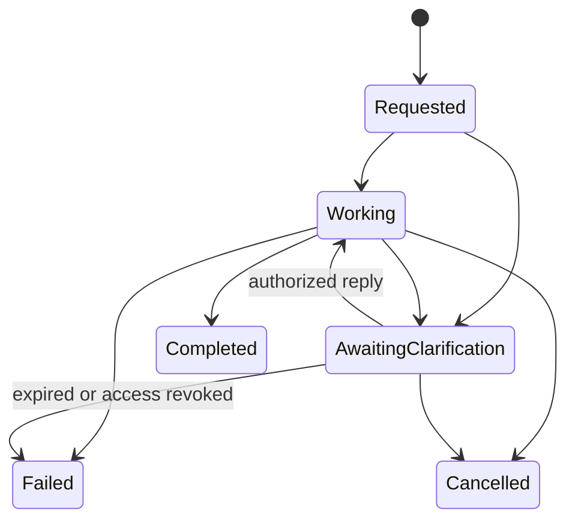
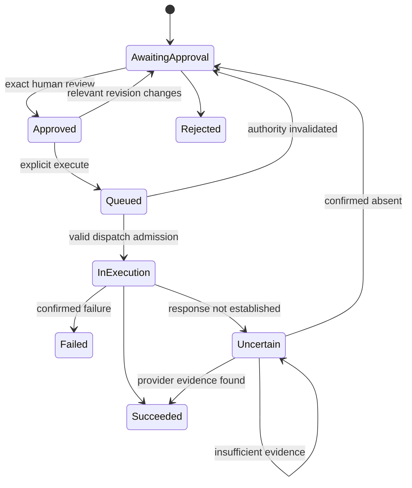

# Memento - Domain Specification

Version 1.0 - 2026-10-28 - Tactical DDD target model; implementation and human acceptance pending.

Read the [Product Specification](memento-spec.md) for product language, strategic contexts and baseline policies. The [Experience Specification](memento-experience-spec.md) owns observable stories/requirements/scenarios. This document owns domain meaning, state transitions, invariants and public context interfaces. [Technical](memento-technical-spec.md) and [Platform](memento-platform-spec.md) define their realization, not alternative domain models.

## 1. Modelling principles

An entity retains identity through change; an aggregate is a consistency boundary, not a screen or serialized canvas. A value object carries validated immutable meaning. A command requests a change; a domain event reports a committed fact. Queries and composed projections grant no write ownership.

All workspace-owned records carry a WorkspaceId and durable identity. Public references use validated types rather than arbitrary JSON paths. A represented record and its Placement retain separate identities and revisions. Historical evidence cannot depend on the continued existence of a working-board node.

The five contexts remain modules of one application. Rules spanning aggregates are executed through their owning application use cases and a local unit of work. Cross-context orchestration calls published interfaces; it does not acquire another context's repository. Events may support Activity and durable publication without requiring event-sourced storage or a message broker.

## 2. Shared reference vocabulary

| Value | Required meaning |
| --- | --- |
| ActorReference | Human identity and Membership, or AgentRole/Run plus initiating Membership, or a named system operation. Display names are projections. |
| RecordReference | WorkspaceId, record kind and stable record ID; an optional revision is explicit, never inferred from geometry. |
| EvidenceReference | WorkspaceId, target kind/ID and exact content revision or ObservationId. Resolution returns the preserved content and provenance. |
| Revision | Monotonic accepted version for the relevant consistency boundary; content, annotation, arrangement and personal-marker versions are distinct. |
| SourceIdentity | Provider, original connection binding, native resource/account and stable native record identity; scope changes cannot reuse it for a different target. |
| ConnectionBinding | Provider/endpoint, external account and resource scope, with a configuration revision and declared capabilities; no credential secret is public content. |
| ContextSelection | Explicit ordered/deduplicated EvidenceReferences and authorized context supplied to a run; later selection changes cannot mutate it. |
| PlacementGeometry | Finite board-space coordinates, dimensions and optional frame identity; viewport translation/zoom is separate. |
| ReviewedOperation | Exact operation kind, binding/target, payload, referenced Decision and relevant prerequisite/configuration revisions. |
| OperationIdentity | Client command identity plus scope/actor and canonical request fingerprint, used for replay/deduplication. |
| TemplateReference | Stable template ID and immutable template version used for a new composition. |

Historical actor names may be retained as display snapshots for audit, but renaming a person does not change their identity. Provider timestamps and Memento capture/commit timestamps are recorded separately.

## 3. Workspace and Access

### 3.1 Model and consistency

| Aggregate / entity | Owns | Important references |
| --- | --- | --- |
| Account | Provisioned global human identity, normalized login email, credential/recovery policy, active/disabled state. | Credential/session references; never automatically a workspace member. |
| GuestIdentity | Durable scoped human identity and display name. It has no global password or unrelated workspace access. | Exactly one workspace; Membership and re-entry invitations. |
| Workspace | Name/description, active state and authority revision; membership/last-owner consistency is controlled through workspace use cases. | Memberships and board identities, without embedding their contents. |
| Membership | Human identity, workspace, Owner/Editor role and active/revoked state. | Account or GuestIdentity; authority/audit history. |
| Invitation | Issuer, target workspace, Editor role, token digest, expiry, redemption/revocation state and optional existing guest Membership for re-entry. | Issuer and eventual redeemer; optional recipient restriction. |
| Session | Opaque authenticated-session identity, actor binding, expiry and revocation. | Account or GuestIdentity; authorization resolves current Membership. |
| RecoveryRequest | Single-use token digest, account, expiry and consumed state. | Verified recovery address; reset audit. |

Workspace Membership changes serialize against the workspace's authority revision. Account identity can belong to several workspaces; guest identity is bound to one. A Workspace creation command atomically establishes its initial Owner and first Board through orchestration with Visual Collaboration. A board failure rolls back creation rather than leaving a successful but unusable workspace.

Session policy is defined in Technical section 2. An invitation defaults to seven days and one redemption. Repeating the same successful redemption operation returns its original result; a different attempted redemption of a consumed token fails. Tokens are credentials and are never stored in Activity or ordinary logs. Account recovery establishes credential control, not new Memberships.

### 3.2 Published commands and queries

| ID / command | Initiator and precondition | Result / committed facts |
| --- | --- | --- |
| WA-01 Authenticate / EndSession | Valid account credentials, or a current session for sign-out. | Session established/revoked; invalid credentials create no authenticated state. |
| WA-02 RequestRecovery / RedeemRecovery | A verified recovery address; valid unused recovery token at redemption. | Generic request response; credential replaced and prior account sessions revoked on success. |
| WA-03 CreateWorkspace | Active account holder; valid name and initial access choice. | Workspace, Owner Membership and first Board created, with their IDs. |
| WA-04 IssueInvitation / RevokeInvitation | Active Owner in target workspace. | Invitation Issued / Invitation Revoked. Re-entry invitation names the existing guest Membership internally. |
| WA-05 RedeemInvitation | Valid, unexpired, unrevoked token and permitted actor/name; recipient binding if configured. | Membership established or existing guest access resumed; Invitation Redeemed; scoped session. |
| WA-06 ChangeMembership / TransferOwnership | Active Owner and expected authority revision; at least one active Owner remains. | Membership Role Changed / Membership Revoked / Ownership Transferred. |
| WA-Q1 ResolveActor / Authorize | Session plus requested workspace/capability. | Current authority or a uniform denial; no role is accepted from client input. |
| WA-Q2 ListWorkspaces / ListMembers | Authenticated actor; Owner required for invitation administration. | Authorized catalogue; members and pending invitation metadata, excluding token digests/secrets. |

An account invitee already holding Membership receives the existing Membership, not a duplicate. Identity verification or a bound recipient condition is checked independently of the chosen display name. A guest cannot choose a prior guest ID to impersonate; re-entry binding originates from an Owner-issued invitation.

Removal stops future access, closes subscriptions and invalidates that member's unsubmitted approvals. Recorded contributions, Decisions and outcomes retain identity. Transfer is atomic and targets an active account-backed member; invited guest Membership remains Editor in this release. Removing/demoting the last Owner is rejected. A later invite does not silently erase revoked membership history.

## 4. Collaborative Knowledge

### 4.1 Records and revision ownership

| Aggregate | Business state and invariants |
| --- | --- |
| Note | Freeform text, content revision, attributable revision history. The first nonempty line derives a reference label; it is not a second editable title. |
| Proposal | Option/explanation, origin, supporting ContextSelection/EvidenceReferences, content revision, review state and adopted-version reference. |
| Decision | Immutable accepted statement, rationale, recorder/time and pinned evidence; supersession metadata is append-only relative to accepted meaning. |
| Relationship | Validated typed/directed endpoints, author and revision. Domain-specific creation rules protect supersession and Action prerequisites. |
| ContentRevision | Immutable historical Note/Proposal content and attribution, retained whenever referenced and for ordinary revision inspection. |

A pending Proposal can be edited with a revision check. Changed evidence or explicitly introduced newer observations can make it stale; adoption of stale content requires fresh assessment. Adoption records the chosen Proposal revision and creates a distinct editable Note, initially unplaced unless requested. It never locks, converts or deletes original Notes and never records a Decision implicitly.

A local source annotation is an independently revisioned Note, owned here and linked to the selected Source Observation through an explicit `derived-from` reference. A source may have several annotations. The Inspector composes them with the captured source; it does not expose an editable field inside the immutable Observation. CK-01 creates/revises that Note and CK-06 records its source relationship in one orchestrated operation. Refresh leaves annotation content and its original reference unchanged.

A Decision requires a nonblank chosen statement, rationale and at least one valid EvidenceReference. It may use human Notes directly. A new unrelated Decision can coexist with other current Decisions. Accepted meaning is never edited in place: correction or changed direction records a new superseding Decision. Supersession atomically marks the particular predecessor, creates the successor and relationship, and prevents cycles or competing successors.

### 4.2 Semantic relationships

| Type | Direction and valid use | Ownership consequence |
| --- | --- | --- |
| supports | Supporting material to supported Note/Proposal/Decision. | Knowledge validates endpoints. Where used as evidence, a separate EvidenceReference pins the material revision. An edge alone is insufficient. |
| derived-from | Derived record to originating Note/Proposal/Observation/Action. | Preserves attribution/origin without asserting a human commitment. |
| depends-on | Dependent Note/Proposal/Action to prerequisite of a permitted kind. | Knowledge protects the graph; only Action-to-Action prerequisites affect execution through Connected Work. |
| supersedes | New Decision to earlier Decision. | Created only by RecordSupersedingDecision; never by drawing or a generic edge editor. |
| results-in | Decision to resulting Action. | Created by the Action preparation use case using a real Decision reference. |

All endpoints are resolvable in the same workspace. Source endpoints reference Source Records/Observations through Connected Work's public resolver. Evidence references remain exact even if a current-record relationship is shown in a projection. Reject dangling endpoints, prohibited endpoint kinds and self-supersession. Execution-prerequisite cycles are rejected. A visual link is a different Visual Collaboration record and cannot be promoted by changing its label.

### 4.3 Published use cases

| ID / command or query | Preconditions | Outcome and failure meaning |
| --- | --- | --- |
| CK-01 AddNote / ReviseNote | Authorized Member or explicitly permitted Run; expected content revision on revision. | Note Added / Note Revised; stale write returns conflict and preserves accepted content and draft. |
| CK-02 SubmitProposal / ReviseProposal | Authorized actor, valid content/context; pending state for revision. | Proposal Submitted / Proposal Revised; exact supporting revisions retained. |
| CK-03 AdoptProposal / RejectProposal | Member; current pending version for adoption; pending/stale for rejection. | Proposal Adopted with new Note reference, or Proposal Rejected. No Decision or placement is invented. |
| CK-04 RecordDecision | Member, valid statement/rationale/evidence. | Decision Recorded; optional placement is separate orchestrated intent. |
| CK-05 RecordSupersedingDecision | Member; current identified predecessor; expected revision and cycle-free chain. | Successor recorded and predecessor superseded atomically; unrelated Decisions stay current. |
| CK-06 EstablishRelationship | Authorized actor and allowed scoped endpoints/type. | Relationship Established; unsupported semantic meaning is rejected rather than reduced to a drawing. |
| CK-Q1 ResolveRecord / ResolveEvidence | Authorized workspace actor and valid record/revision. | Current or exact historical content, with attribution and status. No automatic substitution of latest revision. |
| CK-Q2 SearchKnowledge / TraceRecords | Workspace access; text or root-reference/cursor. | Current record matches including unplaced records; navigable relationships, history and pinned references. |

The revision used for review/evidence is checked again at commit. Superseding a Decision invalidates pending Action approvals based on its current authority where those operations have not crossed the dispatch boundary; it does not reverse an operation already submitted.

## 5. Visual Collaboration

### 5.1 Composition and personal state

| Aggregate / projection | Ownership |
| --- | --- |
| Board | Workspace/name/identity and composition membership; sequence watermark for committed updates. Does not embed all Note content in one aggregate. |
| Frame | Board/name/bounds and arrangement revision. Its members are explicit Placement references. Moving a frame may atomically arrange its identified member placements. |
| Placement | Board, represented record, arrangement revision, geometry, optional Frame, Note colour and (for a source) selected ObservationId. |
| VisualElement | Board-scoped Text, Shape or Ink with identity, content/style, attribution and revision; its Placement supplies geometry. |
| VisualLink | Board-scoped endpoint Placements/visual elements and optional display label; drawing semantics only. |
| TemplateDefinition | Stable ID, immutable version, structural frames, editable prompt content, geometry and visual links. |
| MemberBoardState | Member/Board favorite, last-visit watermark and revision. Does not change shared material. |
| Presence | Ephemeral active session/user/selection/drag preview; no evidential revision. |

A record can have at most one active Placement on a particular board in v1. It may appear on other boards in that workspace. Removing a Placement preserves the represented record and its evidence. Restoring is explicit. No first-release general hard-delete operation erases cited knowledge.

Note colour is a presentation property and does not increment semantic content revision or mark a Proposal stale. Frame containment is explicit, not inferred as permanent ownership from current coordinates. Loose placements are legal. A frame move carries only its validated members; a stale member revision causes an understandable batch conflict rather than partial movement.

Visual links refer to representations, not evidence. Removing an endpoint Placement removes/hides its active visual links in the same composition transaction, with recoverable visual history. Semantic relationships remain available in Traceability. Ink erasure removes the selected stroke; it does not remove cards or knowledge.

### 5.2 Commands and projections

| ID | Use case and result |
| --- | --- |
| VC-01 CreateInitialBoard / InstantiateTemplate | Invoked by authorized workspace creation orchestration. Creates fresh Board/Frame/record/Placement/link IDs and records template origin/version. No real Decision, capture or approved Action is seeded. |
| VC-02 PlaceRecord / RemovePlacement / RestorePlacement | Member or permitted arrangement request. Validates board/record scope; source placement pins a specific Observation. Emits Placement Added/Removed/Restored. |
| VC-03 ArrangePlacement / ArrangeFrame / SetNoteColour | Expected arrangement revisions; validated finite geometry and Frame membership. Emits Placement/Frame Arranged. Content revisions stay unchanged. |
| VC-04 CreateVisualElement / ReviseVisualElement / EraseInk | Authorized member, supported element type and relevant revision. Emits Visual Material Added/Revised/Removed. |
| VC-05 ConnectVisually / RemoveVisualLink | Valid same-board endpoints; no self/duplicate directed visual link. Emits Visual Link Drawn/Removed; creates no semantic Relationship. |
| VC-06 ApplyVisualUndo | A new revision-aware inverse of a recorded composition operation; checks affected revisions and leaves knowledge/Actions alone. |
| VC-07 SetFavorite / MarkBoardVisited | Authenticated member and accessible Board; records personal preference/watermark idempotently. |
| VC-Q1 LoadBoard / ListBoards / PreviewBoard | Authorized actor. Current placed records, explicit displayed observations, geometry, links, known revisions and watermark; preview omits unplaced records. |
| VC-Q2 ListTemplates / GetTemplate | Read built-in definitions; their creation operation still requires account/workspace authority. |

Viewing a board advances only that member's visit watermark after successful snapshot display. Newer unseen events arriving during loading remain countable. Board search filters placed content without altering the model; retained-knowledge search uses CK-Q2. Viewport, selected tool, unsubmitted selection and panel visibility are personal interaction state. A saved preference is never evidence of a Decision.

## 6. Agent Participation

### 6.1 Conversations and runs

A Conversation belongs to one Board and its workspace. Members share its immutable Messages, supplied evidence references and run results. The first release has one conversation per Board and one nonterminal Run per Conversation. Concurrency returns a visible busy state; a member may keep a draft and retry after completion/cancellation. Members may inspect all permitted prior runs through Activity.

| Record | Meaning |
| --- | --- |
| Message | Human/agent author, text, creation time, attached references and optional RunId. Original messages are not silently rewritten. |
| AgentRole | Facilitator or Action Coordinator; bounded permitted tools, independent of human workspace role. |
| AgentRun | Requesting Membership, role, message/context references, granted capabilities, configured limits, progress and state, tool attempts and contribution references. |
| ContextSelection | Submitted attachments plus an explicit manifest of any related context loaded through permitted tools; exact versions and provenance are recorded. |

Attaching selected cards resolves their displayed versions, including the card's pinned ObservationId. Sending freezes the attachments and records what the runtime actually supplied. A server may resolve related in-workspace links only within granted tool scope and must add those exact references to the manifest; it cannot fetch fresh provider state or broaden to private content. Changing selection after attachment is not a context update.

The role can ask clarification without attachments. The reply becomes recorded input for that same Run; it does not substitute newer versions for its context. Baseline limits are 120 seconds cumulative active processing and eight tool calls; time waiting for clarification is excluded from active processing but expires after 24 hours. Deployment configuration may lower limits. Exhaustion terminates visibly. Every resumption rechecks authority and remaining budget.

### 6.2 Public boundary

| ID | Preconditions and result |
| --- | --- |
| AP-01 SendMessage / RequestAssistance | Member, authorized Board, supported role and permitted attachments; no other active Run. Message Recorded / Agent Run Requested. |
| AP-02 ProvideClarification | Requesting member, same waiting Run, valid authority and unexpired wait; records reply and resumes original context. |
| AP-03 CancelRun | Requesting member or Owner; records cancellation request and stops future tool admissions. Already submitted Actions retain independent tracking. |
| AP-04 RecordContribution | Runtime acting under granted Run capabilities; schema-valid result, resolvable references and freshness evaluation. Calls CK-02 or Connected Work's proposal interface; returns contribution references. |
| AP-Q1 ReadConversation / InspectRun | Member access to Board/workspace; returns public messages, context manifest, observable tool outcomes and status, never private model reasoning or secrets. |

A Facilitator result is an attributable Proposal or permitted working contribution. Arrangement suggestions are reviewable proposals over placement revisions, with explicit apply. An Action Coordinator result is a draft operation; neither role can record a Decision or Approval. Invalid references fail validation instead of becoming fictional evidence. Partial valid contributions remain attributable if a later step fails; the run result explains that partial outcome.

## 7. Connected Work

### 7.1 Source identity and evidence capture

| Aggregate / entity | Ownership and rules |
| --- | --- |
| Connection | Workspace-owned service binding/capabilities/configuration revision and server credential reference; Owner manages it. A private Connection additionally belongs to one human identity and is not enumerable by other members. |
| SourceRecord | Stable native identity and original binding; indexes immutable observations and import identity. Its newest-observation index cannot automatically advance displayed references. |
| SourceObservation | Immutable selected content, provider revision/fingerprint, native timestamps, capturedAt, capturing actor/operation and publication scope. |
| CaptureAttempt | Requested import/refresh, actor, target, start/end, errors, result ObservationId and display-advancement outcome. |
| CapturePublication | Personal source owner's explicit selection, audience and provenance. Publication creates workspace evidence without sharing the private Connection. |

CW-01 ConfigureConnection requires Owner authority. Read, write and publication capabilities are distinct. A permitted reader may browse/import a workspace Connection; private browsing requires its owner identity. Captured content is treated as data, never an instruction or grant of authority.

CW-02 BrowseAndImport verifies workspace/resource scope, fetches only on request and normalizes a selected native record. Deduplication on binding/native identity and fingerprint prevents repeat import from creating duplicate source identity. Placement creation separately names the target Board. A second legitimate observation can reuse content if unchanged, with a distinct attempt record.

CW-03 RefreshReference names the Placement/display reference, expected arrangement revision and its original SourceIdentity. It rechecks current read authority for that original binding/resource, retrieves on demand and creates/reuses an Observation. It then advances only the addressed Placement if its expected revision still holds. If the placement changed during retrieval, the captured observation remains inspectable and the UI reports a conflict; no unrelated board advances. New capture, deduplication, attempt outcome and applicable update commit atomically. Provider I/O never happens inside a database transaction.

CW-04 PublishPersonalCapture requires the private source owner, an explicit text/metadata preview and workspace audience confirmation. The source owner must also be an active member of that workspace. Audience means its authorized members, including later members. Content excludes attachments and unselected thread text. Published evidence is immutable; a new explicit publication produces a new linked capture. There is no recipient-side refresh through the publisher's private authorization. Original navigation uses the viewer's own provider permission.

CW-Q1 ResolveObservation/History and CW-Q2 BrowseScopedSources expose only permitted normalized fields and safe locators. Capture visibility follows workspace membership; provider access follows separate capabilities. Loss of provider access prevents new reads without retrospectively mutating recorded evidence. A Connection change never retargets a SourceRecord to another mailbox/project.

### 7.2 Actions, approvals and outcomes

An Action owns proposed content, expected target/binding, supporting Decision/evidence, prerequisites, approval history, attempts and Outcome. Approval is an immutable authorization value held in its history, with current validity evaluated against Action/configuration/authority revisions. A native task or sent message produced by an Action is a separate SourceRecord, not the Action or Decision itself.

| ID | Public use case |
| --- | --- |
| CW-05 ProposeAction / ReviseAction | Member or permitted coordinator Run; current Decision and declared create-task/send-reply capability. Records exact reviewable fields; revision clears current Approval. |
| CW-06 SetActionPrerequisite | Member; allowed Action pair, same workspace, cycle-free dependency. Replaces reviewed prerequisites and invalidates prior Approval. |
| CW-07 ApproveAction / RejectAction | Active Member, exact current Action revision, target and binding scope; human-supplied authorization only. Records authorizer/time/fingerprint. |
| CW-08 ExecuteApprovedAction | Explicit member execute request; revalidates Approval, current authority/Decision/configuration and succeeded prerequisites at dispatch admission. Queues one durable operation identity. |
| CW-09 RecordOutcome / ReconcileOutcome | Execution process, actual returned/observed provider evidence and persisted attempt identity. Records success, known failure or uncertainty. |
| CW-Q3 ReviewAction / InspectOutcome | Authorized Member. Exact payload, approval validity, prerequisite/Decision links, attempts and returned/captured external identity. |

Task review includes target project/stack, title, content, assignee, due date and Decision reference. Reply review includes mailbox/sender, recipients, subject, body and native thread reference. Approval binds their complete normalized values and current Action revision. An external actor or agent cannot supply approval.

Proposed content can be revised only while AwaitingApproval, Approved or confirmed Failed; revision clears Approval and returns to AwaitingApproval. Queued, InExecution, Uncertain, Succeeded and Rejected Actions cannot have their submitted/rejected meaning overwritten. A different intended operation after completion/rejection requires a new Action. A known failure may be reviewed again only after its attempt evidence establishes that repeating the required provider work is safe.

A provider timeout after submission is not evidence of failure. Lease expiry does not authorize a second submission. Reconciliation may inspect the submitted operation's result under the original resource scope; unresolved cases remain Uncertain with an inspect/reconcile path. Confirmed absence clears Approval and requires a new review before retry. A succeeded Action is not replayed under a new worker lease. Cancellation of an Agent Run does not cancel a submitted task or retract delivered mail.

## 8. Cross-context rules and invariants

DR-01 through DR-14 retain their identifiers from the earlier baseline, with static-evidence and traceability wording clarified. Additional rules cover the expanded product.

| ID | Normative invariant |
| --- | --- |
| DR-01 | Reads, writes, evidence resolution, searches, subscriptions and agent tools remain within current authorized workspace scope. |
| DR-02 | Contributions, captures, Decisions, Approvals and outcomes identify durable human, agent/run or system origin and time. |
| DR-03 | Geometry, colour, frames and visual links organize composition; they never assert evidence, record a Decision or authorize an operation. |
| DR-04 | External systems own native records; Memento preserves immutable captured observations. Only requested import/refresh/publication introduces external changes. |
| DR-05 | EvidenceReferences pin exact retrievable revisions/observations; later edits, refreshes and placement removal do not rewrite them. |
| DR-06 | Only an authorized human Member records a Decision; adoption or applying an arrangement cannot create one implicitly. |
| DR-07 | Changed known context marks dependent pending Proposals stale or requires reassessment. Unseen provider edits do not imply freshness knowledge. |
| DR-08 | Changed accepted meaning creates a new Decision; supersession preserves both, is acyclic and affects only its identified predecessor. |
| DR-09 | External dispatch requires valid human Approval of the exact Action/target/configuration; relevant changes invalidate it. |
| DR-10 | Intent, queueing, submission, success, known failure and uncertainty stay distinguishable; uncertainty is reconciled before repeat submission. |
| DR-11 | Placement removal preserves semantic records and cited evidence; visual undo cannot reverse Decisions, Approvals or external outcomes. |
| DR-12 | Acknowledged changes survive concurrent work, reconnect and restart; incompatible revisions conflict rather than silently overwrite. |
| DR-13 | Runs obey role/context/capability limits; cancellation blocks future tool admissions, independently tracking already submitted operations. |
| DR-14 | One-member and multi-member workspaces use the same knowledge, evidence, approval and history rules. |
| DR-15 | A guest invitation grants one scoped Membership; a name, source author or local role setting cannot grant authority. |
| DR-16 | Membership changes are revision-checked and leave at least one active Owner; revocation ends future authority without erasing attribution. |
| DR-17 | Workspace and first-board creation/template instantiation are atomic and use fresh scoped identities; template prompts are not accepted Decisions. |
| DR-18 | A displayed source reference names an Observation; a global newest-observation index cannot silently advance it. |
| DR-19 | Refresh never overwrites captured content, local annotation or knowledge meaning; only explicitly addressed display references advance. |
| DR-20 | Personal publication shares only confirmed content/audience; private authorization, attachments and send-as rights are not transferred. |
| DR-21 | Conversation input and run ContextSelection are recorded; changing board selection does not replace submitted attachments. |
| DR-22 | Domain records remain usable without a Placement; Traceability and authorized retained-record search can retrieve them. |
| DR-23 | Favorites, visits, read markers and view state belong to the person; none changes shared truth or another member's state. |
| DR-24 | A visual link cannot become a semantic Relationship through relabelling; Action dependency and supersession use explicit commands. |
| DR-25 | SQLite and PostgreSQL adapters enforce the same command outcomes, invariants, evidence identity and durable-operation semantics. |
| DR-26 | An Activity event reports committed facts; viewing/reading it is not adoption, Decision recording, Approval or provider refresh. |

## 9. Published events, projections and consistency examples

Events carry EventId, WorkspaceId, originating command/operation, ActorReference, committedAt and relevant record/revision references. Board association is explicit and may be many-to-many; a semantic event is not duplicated in the workspace timeline merely because several boards display it. Delivery may repeat, so projection consumers deduplicate EventId.

The named facts in sections 3-7 form the published language. Additional facts include Source Imported, Source Refresh Requested/Completed/Failed, Capture Published, Agent Clarification Requested/Received, Run Completed/Failed/Cancelled, Action Approved/Queued/Submitted/Succeeded/Failed/Uncertain and Member Board Preference Changed. Failed requests return errors without emitting a success fact. Private authentication/recovery diagnostics are not public workspace Activity.

Home composes Access's allowed Workspaces, Visual Collaboration's boards/previews and personal markers. Activity composes permitted committed events plus a member's read markers; event owners retain their underlying records. Traceability composes Knowledge relations/evidence and Connected Work outcomes, including unplaced material. These are read projections, not competing aggregates.

| Concurrent/interrupted case | Consistent result required |
| --- | --- |
| Two Note revisions from the same base | One is accepted, the other conflicts with current revision and preserves its draft. |
| Two successors for one current Decision | Only one supersession transaction succeeds; the other must inspect the accepted successor. |
| Membership revoked while a command is being authorized | Authorization and mutation share an authority consistency boundary; a command cannot commit using a stale unprotected membership read. |
| Refresh completes after the card was moved/removed/refreshed elsewhere | Preserve the obtained Observation, report the display revision conflict, and leave the intervening composition intact. |
| Two equivalent imports | One SourceRecord identity and nonduplicated observation content; each valid request has a recoverable result. |
| Action worker restarts after provider submission | Recover/reconcile the original attempt; do not infer that replay is safe from a new lease. |
| SQLite busy/deadlock/serialization retry | Retry only a rolled-back database unit of work with the same operation identity; never repeat untracked external I/O. |

Technical section 4 defines database and publication mechanisms for these outcomes. Passing isolated model checks is necessary but not proof of either adapter, real provider integration or human acceptance.
