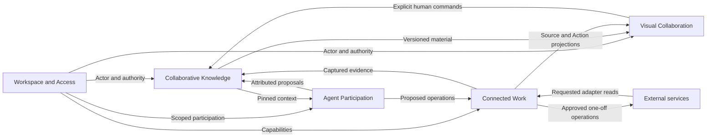

# Memento - Product Specification

Version 1.0 - 2026-10-28 - Target product baseline; implementation and human acceptance are recorded separately.

Memento is a shared visual workspace in which people develop ideas, bring captured evidence into a discussion, consult AI, record decisions and carry approved follow-up work into external systems. Its durable value is the connection between an outcome and the information, people and choices that explain it.

This is the entry point to a five-document specification set. It replaces the earlier demonstration-centred functional/domain edition. Detailed experience and tactical modelling now have their own authorities; their definitions are linked rather than duplicated here.

## 1. Reading order and authority

| Document | Owns |
| --- | --- |
| This Product Specification | Product outcomes, scope, actors, ubiquitous language, strategic DDD, capability inventory, product policies and functional acceptance. |
| [Experience Specification](memento-experience-spec.md) | User journeys, story map, individually specified stories, observable requirements/scenarios and mockup interaction contracts. |
| [Domain Specification](memento-domain-spec.md) | Tactical model, aggregates, value objects, invariants, lifecycles, commands, queries, domain events and context interfaces. |
| [Technical Specification](memento-technical-spec.md) | Transport/persistence/execution contracts, security, concurrency, external adapters, operating behaviour and AC release gates. |
| [Platform Specification](memento-platform-spec.md) | Selected frontend/Bun stack, dual database adapters, module layout, UI components, configuration and Podman conventions. |

The [Design and Implementation Guide](../Design%20and%20Implementation%20Guide.md) owns the modelling/delivery workflow. The [v1.0 Release Plan](../delivery/releases/v1.0/plan.md) owns sequencing, slice briefs, actual evidence and human review. [Test Environment](../test-environment.md) owns the existing external-service package and operating procedures.

The user's explicit product rules and platform selections take precedence over earlier documents. The linked [HTML mockups](../mockups/index.html) are canonical for the visible product experience. Normative behaviour in this set makes their intent implementable, including error and permission cases that their simulations do not enforce. Where source-sync examples conflict, the static-evidence policy in section 6 applies. Future behaviour changes update the owning text and affected visual references together.

The [comparison](research/comparison-mockup-versus-spec.md) is a historical discrepancy register; its original descriptions of obsolete text and technologies are not current requirements. Its resolution ledger links the replacement definitions. The old generated concept image is retained as historical material and is no longer embedded as the UI authority. Technical spikes demonstrate particular experiments, not completion of this product baseline.

## 2. Outcomes and product boundary

Memento supports collaborative sensemaking and follow-through for an individual or a small team. A participant should be able to:

1. Enter through a real account or a scoped invitation and find only permitted work.
2. Start a workspace, alone or from a template, and resume it later.
3. Contribute and arrange freeform material while preserving authorship and accepted changes.
4. Deliberately capture external evidence without creating an always-synchronized mirror.
5. Give an agent explicit context, understand its contribution and retain human authority.
6. Record a decision with reasons and exact evidence, independently of presentation or proposal adoption.
7. Review a specific external operation, approve it and understand its actual outcome.
8. Recover the history, including records no longer displayed on the working board.

The product is broader than one Atlas fixture. Atlas Launch is a repeatable acceptance story, not a restriction on the number of workspaces or the shape of every board. A workspace may contain several boards; the first-release creation UI creates a workspace and its first board together. Existing/seeded boards are independently selectable. A standalone Create board toolbar is not part of the canonical first-release UI.

## 3. Actors and participation

| Actor | Objective and authority |
| --- | --- |
| Account holder | Signs in with a provisioned account, creates owned workspaces, accepts invitations, and resumes permitted work. Global account identity does not grant membership everywhere. |
| Workspace Owner | Contributes as a member and manages that workspace's invitations, members and connections. Ownership is a workspace role. |
| Workspace Editor | Contributes, arranges material, requests AI, records Decisions and approves exact external Actions within permitted capabilities. |
| Invited guest | Joins one workspace without a global account, using a valid invitation. Has an Editor Membership and durable guest identity; cannot create other workspaces or manage connections by virtue of the invitation. |
| Facilitator | An Agent Role that analyzes and organizes supplied material and proposes editable contributions. Cannot impersonate a member, decide or approve. |
| Action Coordinator | An Agent Role that prepares follow-up Actions. Execution belongs to the approved-action application service; a role name is not approval authority. |
| Connector/execution worker | Performs an authorized capture, requested refresh or approved operation and records actual evidence of the result. It does not continually monitor external records. |
| External correspondent | Supplies a message or other native record. Authorship of external content confers no Memento access or tool permissions. |

One-member workspaces use the same records, rules and approval steps as shared workspaces. Presence indicates an active session, not membership or authority. Human contribution attribution uses a durable identity, not a display-name string.

## 4. Ubiquitous language

| Term | Product meaning |
| --- | --- |
| Workspace | Shared subject area and authorization boundary for knowledge, boards, members and connections. |
| Membership | A durable relationship between a human identity and one workspace, with role and participation state. |
| Invitation | A time-limited, revocable capability to establish or resume a specified Membership. |
| Board | A visual working composition within a workspace. It is not the sole store of its represented knowledge. |
| Note | Freeform authored text. Its first nonempty line supplies a reference label; it has no independent title field or business-state badge. |
| Frame | A named visual container with explicitly recorded placement membership and geometry. |
| Placement | A record's representation on a board, including geometry and visual properties. Content and arrangement have independent revisions. |
| Visual element / visual link | Board-owned ink, text, shape or drawing connection. Neither proximity nor an arrow asserts evidence, acceptance or an execution dependency. |
| Relationship | An attributable, typed, directed semantic connection with validated endpoints in one workspace. |
| Connection | Scoped authorization/configuration for requested access to an external service. It does not imply continuous synchronization. |
| Source Record | Memento's stable reference to one native external identity and its observation history. |
| Source Observation | Immutable captured content, provenance, native revision/fingerprint and capture time. It records what was reported, not a guarantee of truth. |
| Source Card / Task Card | A presentation of an explicitly selected Source Observation. Task status is the status observed at capture time. |
| Evidence Reference | A retrievable reference to an exact content revision or Source Observation. |
| Proposal | A suggested option from a person or agent, with review state and supporting context. Adoption can create editable material; it does not itself record a Decision. |
| Decision | A human-recorded statement, rationale and pinned evidence. Accepted meaning is immutable. Several unrelated Decisions may be current. |
| Supersession | A new Decision explicitly replacing an earlier Decision while preserving both and their evidence. |
| Action / Approval / Outcome | Respectively a proposed external operation, a member's authorization of its exact version/target, and evidence of what actually happened. |
| Conversation / Agent Run | A board-shared exchange of messages, and a bounded attempt by a named role using recorded input and tool limits. |
| Context Selection | Exact material revisions deliberately attached to a request. Selecting cards alone does not attach them. |
| Traceability | An informational projection connecting records, pinned evidence, revisions, Decisions and Actions. It is not a second editable canvas. |
| Activity / read marker | Meaningful committed events, and a member's personal record of having viewed them. Reading is not approval or adoption. |
| Template | Versioned editable starting structure, instantiated with fresh workspace/board/record IDs. It does not pre-record a team's Decisions. |

The Domain Specification defines contextual types, identity and consistency rules. UI labels may be plainer than internal names, but they must preserve these distinctions.

## 5. Strategic DDD and context map

The core subdomain is **Collaborative Knowledge**: preserving the meaning and evidence of contributions and Decisions. **Visual Collaboration**, **Agent Participation** and **Connected Work** support it. **Workspace and Access** provides generic identity and authorization capabilities. These classifications describe product responsibility, not deployment topology.

| Context | Owns | Published boundary |
| --- | --- | --- |
| Workspace and Access | Accounts, guest identities, sessions, workspaces, Memberships, invitations and access policy. | Actor resolution, authority snapshot, authorized workspace catalogue and membership changes. |
| Collaborative Knowledge | Notes, Proposals, Decisions, semantic Relationships, Evidence References and retained-knowledge search. | Versioned record queries and authorized knowledge commands. |
| Visual Collaboration | Boards, Frames, Placements, visual elements/links, template structures, favorites/visits and presence. | Board projections, composition commands and personal navigation state. |
| Agent Participation | Conversations, Messages, Agent Roles, Runs, Context Selections and run attribution/control. | Assistance requests, progress, pinned context and contribution references. |
| Connected Work | Workspace/private Connections, Source Records/Observations, capture publication, requested refresh, Actions/Approvals and outcomes. | Scoped capture/read operations, evidence resolution and approved external execution. |

Access is upstream of authorization consumers; it grants identity and role facts, not permission to bypass each consumer's rules. Knowledge and Connected Work publish versioned references consumed by agents and views. External adapters form an anti-corruption layer: provider identities, statuses and errors are translated into Memento language. Source text cannot redefine commands or capabilities.

Contexts collaborate through explicit application interfaces and local units of work. They share one Bun application and a logical relational model, with SQLite and PostgreSQL implementations. They do not write each other's repositories directly. Activity, Home, previews and Traceability compose projections across owners; a new screen does not automatically create a bounded context. Detailed contracts are in the Domain and Technical Specifications.

## 6. Product policies and baseline decisions

### 6.1 Static external evidence

Import and refresh are deliberate member operations. No timer, webhook, reconnect, page opening, background agent or provider-side edit may silently update an imported reference. A requested refresh can introduce a new immutable observation and advance only the explicitly addressed reference(s). Decisions and submitted runs remain pinned to the observations they used. Failed refresh preserves the prior evidence, annotations and placement.

Opening the original is separate from reading the shared capture and separate from refreshing. The original service checks that viewer's own authorization. Connection health, capture age, native business status and an Action's execution state are separate facts. Internal Memento collaboration remains live: members receive committed imports/refreshes through the application's subscriptions.

Real task creation and email reply delivery remain in scope as one-off reviewed operations. Reconciliation of an already submitted operation is required and is not continuous monitoring of its native record.

### 6.2 Access and membership decisions

The first-release account route uses provisioned accounts; deployment operators provision them through a documented administrative command. Public self-registration and enterprise identity federation are deferred. Account recovery is real, using the account's verified recovery address; the recovery flow may reuse the existing Access surface without adding a new primary navigation section.

Owners issue single-use Editor invitations, valid for seven days by default, and may revoke them. The Owner can copy the link for delivery; Memento is not required to send an invitation email as an external Action. A valid link permits guest entry with a chosen display name. Guest return after loss/expiry of its session requires an Owner-issued re-entry invitation bound to the existing guest Membership; audit identity is retained. The Domain Specification defines safe redemption and role changes.

Editors, including invited guests, may approve permitted Actions. They acquire no provider credentials or connection-management rights. At least one active Owner must remain. Owner transfer and member removal are deliberate membership operations in the members management flow. Sessions and subscriptions must reflect revoked authority.

### 6.3 Product completeness decisions

All visible non-simulation capabilities in the five screens are in the target baseline: Access, Home/workspaces, Templates, Activity, the board/tools, contextual knowledge operations, agent chat, captures, reviewed Actions and informational Traceability. Six built-in templates are specified in the Experience Specification. Template authoring, standalone additional-board creation, workspace deletion and unrestricted external-record editing are deferred; existing boards and evidence remain retrievable.

Personal email capture publication is included as a narrowly scoped workflow: its owner previews selected plain message text and the workspace audience before publication. It shares neither attachments, other messages, private connection credentials nor send-as rights. The published capture is immutable. A later publication is an explicit new capture; recipients cannot refresh through the publisher's private connection. Withdrawal/deletion of cited evidence is not a first-release operation.

Each board has one conversation visible to its authorized members, including earlier messages. It supports the two named roles and one active run at a time. Attachments are explicit; clarification continues that run's original context. Runtime limits are configured by the application, not tuned in the ordinary composer.

These are authored baseline product decisions, open to human review; they are not claims that the mockups implemented the policies. Model provider, exact backend toolchain pin and measured reference-host/browser budgets remain implementation decisions with recorded constraints. They cannot alter the settled user-visible policies without a specification change.

## 7. Capability and journey inventory

Existing UJ-01 through UJ-07 retain their identity; the experience document extends them and adds the shell/administration journeys.

| Capability | Journey references | Owning contexts |
| --- | --- | --- |
| Account and invited participation | UJ-08, UJ-09 | Workspace and Access |
| Workspace entry, creation and personal return state | UJ-10 | Workspace and Access; Visual Collaboration |
| Built-in starting structures | UJ-11 | Visual Collaboration; Collaborative Knowledge |
| Shared freeform board | UJ-01, UJ-07 | Visual Collaboration; Collaborative Knowledge |
| Captured working context and publication | UJ-02, UJ-13 | Connected Work |
| Grounded conversational assistance | UJ-03, UJ-07 | Agent Participation; Knowledge; Connected Work |
| Explicit direction and retained reasoning | UJ-04, UJ-06 | Collaborative Knowledge |
| Reviewed task/reply operations | UJ-05, UJ-07 | Connected Work |
| Activity, read state and context navigation | UJ-06, UJ-12 | Projection over all contexts |

See the Experience Specification for stories, scenarios and the story map; see the release plan for their scheduled slices. A journey can cross contexts and a context can support several journeys. Story ordering is not an aggregate lifecycle.

## 8. Functional acceptance

| ID | User-observable target | Journey coverage | Engineering gates |
| --- | --- | --- | --- |
| FA-01 | Alone or together, members create/edit/arrange material, distinguish visual links, understand authorship and resolve incompatible accepted edits. | UJ-01, UJ-07 | AC-02, AC-03, AC-15, AC-20, AC-21, AC-26 |
| FA-02 | A real selected message/task is captured with provenance and original navigation; external edits leave it unchanged until requested refresh. | UJ-02 | AC-05, AC-06, AC-10, AC-12 |
| FA-03 | AI uses explicit permitted context, asks clarification, contributes attributable editable material and exposes progress/control. | UJ-03 | AC-07, AC-15, AC-16, AC-27 |
| FA-04 | A human records direction and reason; adoption is distinct; supersession retains the earlier meaning and evidence. | UJ-04 | AC-06, AC-19 |
| FA-05 | Exact task/reply content is reviewable, only the approved version executes, and real results are independently inspectable. | UJ-05 | AC-08, AC-09, AC-11, AC-13 |
| FA-06 | Task completion in the provider becomes a new capture only after explicit refresh; old Decision evidence remains unchanged. | UJ-02, UJ-05 | AC-06, AC-10 |
| FA-07 | Search, Activity and Traceability recover earlier/unplaced material, Decisions and outcomes after reload/restart. | UJ-06, UJ-12 | AC-04, AC-20, AC-25 |
| FA-08 | Accounts, guests, memberships and provider capabilities grant only their scoped operations; unauthorized direct requests fail. | UJ-08, UJ-09, UJ-13 | AC-08, AC-14, AC-22, AC-29 |
| FA-09 | Conflicts, failed refreshes, waiting/cancelled agents and uncertain submissions explain what is known and what can happen next. | UJ-07 | AC-03, AC-12, AC-13, AC-16 |
| FA-10 | The complete Atlas workflow uses real services/inference and survives repeatable reset/restart on the declared profiles. | All | AC-01, AC-17, AC-18, AC-21, AC-28, AC-30 |
| FA-11 | Members create/resume work through authorized Home and Templates, with meaningful previews and personal favorites/visits. | UJ-10, UJ-11 | AC-23, AC-24 |

All targets are prospective. An authored requirement, rendered mockup or passing isolated spike is not acceptance evidence. The Technical Specification owns measured checks; the release record owns actual outcomes.

## 9. OpenSpec foundation and change governance

The five specifications define target product intent, model and constraints. Existing OpenSpec changes under `openspec/changes/` concern renderer/collaboration experiments and retain their historical scope. They do not certify the target application or automatically select their experimental server/storage/CRDT design.

A future product change identifies its stories, requirement/scenario IDs, domain commands/rules, relevant contracts, platform constraints and release slice. Requirements describe observable behaviour; its design and tasks describe the selected implementation increment. Preserve existing UJ/DR/FA/AC identifiers; new IDs extend their namespaces. Capability boundaries are durable behaviours, not filenames for screens or one capability per aggregate.

The guide defines the authority transition: adopted OpenSpec capability contracts own their detailed requirement/scenario blocks when migrated; the experience catalogue then references those blocks rather than maintaining independent copies. Product purpose, domain rules and platform constraints remain in their owners. Until explicit migration, Experience is the requirement/scenario authority. No unimplemented target may be represented as shipped behaviour merely by creating or archiving a document.

A selected slice is ready to specify when its user outcome, permission boundary, state transitions, invariants, failure paths and verification are defined; non-blocking runtime choices may be resolved in its design. Product implementation starts only on authorization for that slice/phase. This rewrite is documentation work, with human acceptance pending.
