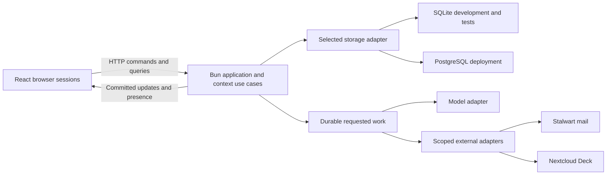

# Memento - Technical Specification

Version 1.0 - 2026-10-28 - Bun application, dual-storage engineering contracts and prospective verification gates.

Read [Product](memento-spec.md), [Experience](memento-experience-spec.md) and [Domain](memento-domain-spec.md) for intent, R/S stories and DR/use-case definitions. This document owns engineering mechanisms and AC-01 through AC-30. [Platform](memento-platform-spec.md) owns specific libraries, code layout and deployment conventions. Targets below require actual implementation evidence; none is established by the specification itself.

## 1. Logical architecture

Memento is a TypeScript modular monolith running on Bun. HTTP commands/queries and authorized WebSocket subscriptions serve a React application. The five domain contexts expose public use cases independent of transport, UI, storage driver and model/provider SDKs. SQLite is the ordinary development/test store; PostgreSQL is the deployment store. Both implement the same logical contracts and must pass shared adapter acceptance checks.

The storage branches are alternatives selected per application instance, not concurrent replicas. Memento does not dual-write or replicate between SQLite and PostgreSQL. The external-service package has its own Nextcloud PostgreSQL database; that is distinct from Memento's selectable store.

State changes, required history, command-deduplication results, event/outbox records and durable work intent commit atomically. Provider/network I/O and inference occur outside database transactions. A separate worker process is optional in deployment; normal SQLite development runs application and worker coordination in one Bun service. No graph database, broker, CRDT or service per context is required.

## 2. Identity, authorization and confidentiality

Account authentication verifies a stored Argon2id credential using a server password facility. Provisioning is an operator command; it is not a publicly callable user-registration endpoint. Accounts have normalized unique login email and a verified recovery address established at provisioning. Recovery delivery uses the configured real recovery mail transport; its operational failure is visible to operators without exposing account existence to the requester.

Opaque sessions use unpredictable tokens, stored server-side by digest, with HttpOnly cookies, SameSite=Lax and Secure under HTTPS. Local loopback HTTP is a documented development exception to Secure, not the deployment setting. Account sessions expire after 12 hours, or 30 days when Keep me signed in was selected; guest sessions expire after seven days and remain workspace-scoped. Sign-out revokes the server session. Password recovery tokens expire after 15 minutes and are single-use; successful replacement revokes existing account sessions. Tokens/credential hashes never enter shared events, URLs in ordinary logs, browser storage or model context.

Mutation endpoints validate request origin and a session-bound CSRF token. WebSocket upgrade validates session and origin; every subscription and subsequent operation is authorized against current membership. Do not treat a guessed BoardId, socket connection or signed-in global Account as permission to read workspace records. Membership/approval dispatch admission participates in the mutation's consistency strategy. Revocation closes affected subscriptions, ends guest authority and blocks future work; already admitted/submitted external operations keep their actual outcome record.

Use bounded authentication/recovery attempts and generic request responses. Baseline policy allows five failed sign-in attempts per account/IP bucket per 15 minutes, then a timed retry response; provisioning/operations may tune limits with recorded justification. Password input is 12-1024 characters for new credentials; authentication never truncates it. Hash cost is configured and measured on the reference host before deployment acceptance. Neither rate limiting nor authentication may block Bun's event loop with synchronous password work.

Workspace queries, search, previews, event payloads, retained revision resolution and agent tools independently enforce scope. Cross-workspace unauthorized IDs return a uniform unavailable result without metadata. Credential references and private connection IDs are omitted from ordinary projections. Captured source text and model output are rendered as text/sanitized content and treated as untrusted data, not executable instructions or tool grants.

## 3. Application and transport contracts

### 3.1 Command envelope and acknowledgement

Every persisted mutation uses an operation identity and validated typed payload. Domain IDs are server-issued UUIDs; counts/revisions/sequences are safe integers serialized consistently. Timestamps are UTC instants with explicit timezone; local display is a client concern. Calendar dates such as task due dates use an explicit date/timezone policy rather than silently converting local midnight.

| Contract field | Meaning |
| --- | --- |
| operationId | Client-generated UUID, stable across retry of the same intent. Scoped with workspace/actor for deduplication. |
| workspaceId / boardId | Explicit requested scope where applicable; validated against actor and target records. |
| expectedRevision(s) | Relevant content/arrangement/authority/configuration versions; batch operations name each affected mutable record. |
| payload | Command-specific validated input described by Domain use cases and the public schema; actor/role is not trusted client input. |
| result | Operation identity, committed record/revision references, affected board watermarks and meaningful outcome; no durable acknowledgement before commit. |

Deduplication stores a canonical request fingerprint and original result in the same transaction as the mutation. Same actor/scope/operation and same fingerprint returns that result after authorization; reusing the identity with different input returns an operation-reuse conflict. A retry after unknown commit outcome checks this record before re-executing the unit of work. Retain records at least as long as a client or durable job can replay the operation; do not expire Action identities while outcome recovery is possible.

Error responses carry a stable code, safe message, correlation/operation ID, field errors where appropriate, current revision references for permitted conflicts, and retry classification. Map unauthenticated to 401, current-role denial to 403, non-visible target to 404, stale/illegal transition or reused operation to 409, invalid input to 422, throttling to 429 and provider/temporary availability to a classified 502/503 or persisted operation failure. An asynchronous operation's attention state is a persisted result, not fabricated HTTP success of the external task.

### 3.2 Published API surface

The paths below are the target API grouping. A change may refine wire schemas without changing story meaning; publish/generated-client validation belongs in the implementation change. Read pagination uses opaque cursors tied to scope and a stable ordering watermark.

| API group | Essential requests and returned projections |
| --- | --- |
| `/api/session`, `/api/recovery` | Sign-in/current-session/sign-out; recovery request/redemption. Current actor and authorized scope; no password/token echo. |
| `/api/invitations` | Issue/revoke under Owner; safe token preview/redemption. Public preview contains only intended workspace/inviter/role/expiry metadata. |
| `/api/workspaces` and `/:id/members` | Authorized list/search, atomic create-first-board, member list/role/transfer/revoke. |
| `/api/workspaces/:id/boards`, `/api/boards/:id/snapshot` | Board catalogue, snapshot plus watermark, personal favorites/visits and preview. Creation is orchestrated by workspace/template flow. |
| `/api/templates` | Read immutable built-in definitions/versions; workspace creation names the chosen version. |
| `/api/workspaces/:id/knowledge` | Note/Proposal/Decision/Relationship commands, current record/details, exact revision resolution and retained text search. |
| `/api/boards/:id/composition` | Place/remove/restore, geometry/frame batches, colour, visual text/shape/ink/link operations and revision-aware undo. |
| `/api/workspaces/:id/connections` | Owner configuration; permitted scoped source browse/import, addressed refresh and capture-attempt/history queries. |
| `/api/workspaces/:id/publications` | Private-source owner preview/confirmed publication; private selection never appears in another member's query before publication. |
| `/api/boards/:id/conversation` and `/api/runs/:id` | Shared messages, submitted attachments/role, clarification, cancellation, public progress/context/result. |
| `/api/workspaces/:id/actions` | Propose/revise, prerequisite, exact review/approve/reject/execute, attempt/outcome/reconciliation. |
| `/api/activity`, `/api/boards/:id/activity`, `/api/workspaces/:id/traceability` | Authorized timeline/filter/search/read state; trace record/evidence/history with explicit related/board references. |
| `/api/events` | Authenticated WebSocket upgrade; authorized board, activity and run subscriptions with resume cursor/watermark. |

Command schemas validate finite geometry, maximum text sizes, allowed kinds/enums and scoped reference shapes before application use cases. Baseline limits: names 1-60 characters, Note/working text up to 20,000 characters, request message up to 8,000, Decision statement up to 1,000 with nonblank rationale up to 20,000, and at most 100 explicit context references per request. Oversized source content is previewed/selected with disclosed limits, never silently truncated as if complete evidence. Batch limits and graph budget are measured before release.

### 3.3 Collaboration and projections

HTTP mutations use expected revisions; WebSockets deliver committed results and ephemeral presence. Each Board has a durable monotonic sequence. A semantic command affecting several Boards publishes appropriately associated updates to each Board; a workspace Activity event has its own identity/order and is not duplicated merely by multi-board display.

An initial snapshot and its sequence come from one consistent read. The server then replays committed updates after that watermark or requires authoritative reload if retention has elapsed. Buffer/catch-up sequencing prevents changes during loading from disappearing. Clients deduplicate event/operation identity, reject backwards revisions and recover gaps. A board sequence is not inferred from WebSocket arrival order. Presence expires and cannot acknowledge persistence.

Drag previews remain local/transient; only committed arrangement commands update durable geometry. Independently owned objects edit concurrently. An incompatible stale edit returns the current permitted revision and preserves the local draft. Arrangement/Frame batches validate all affected revisions atomically. Undo is a new inverse command and may conflict. Read-only projections never become the semantic authority by serializing the entire renderer document.

## 4. Dual database persistence contract

### 4.1 Logical ownership and data integrity

Both adapters persist the same logical records: identity/session/invitation, workspace/membership, board/frame/placement/visual elements/links/templates/personal markers, versioned knowledge/evidence/relationships, conversation/run/context, connections/captures/publications/Actions/attempts, and operation/event/outbox/job state. Context-owned repositories expose business operations and transaction-scoped access, not generic table mutation to other contexts.

Use foreign keys, scoped unique constraints, explicit directed endpoints and check constraints where applicable. Store immutable content revisions and observations separately from current mutable indexes. A Placement displaying evidence has an explicit ObservationId. Do not use React Flow JSON, browser localStorage or a mutable `latest` source view as the authoritative knowledge store.

Shared IDs, timestamps, revisions, nullability, booleans, text normalization and JSON validation have common adapter-level representations. Store timestamps as UTC with millisecond precision at the contract boundary; SQLite may use canonical text and PostgreSQL a timestamp type. JSON fields contain schema-validated payloads; query semantics cannot depend on incompatible engine-specific implicit casts. Search guarantees matching scope/content and retained-record discoverability; identical ranking or database tokenizer implementation is not a requirement.

### 4.2 Transactions and engine-specific implementation

| Concern | SQLite development/test | PostgreSQL deployment |
| --- | --- | --- |
| Driver boundary | Dedicated SQLite adapter using `bun:sqlite`; synchronous statements/transaction bodies behind public asynchronous use cases. | Dedicated PostgreSQL adapter using Bun SQL; awaited transaction-scoped queries on one checked-out connection. |
| Mutation unit | Short `BEGIN IMMEDIATE`/equivalent immediate transaction; serialize writers and handle busy state explicitly. | Transaction with revision compare-and-swap and scoped row locks or serializable/retry protection for cross-record invariants. |
| Cross-aggregate rules | Immediate write boundary plus re-read protected authority/graph state and full validation before commit. | Lock authority/consistency roots in deterministic order and validate protected graph state; plain Read Committed queries alone are insufficient for cycle/last-owner rules. |
| Durability/configuration | Foreign keys enabled per connection, WAL for file-based profile, synchronous FULL, bounded busy timeout; preserve database and WAL consistently. | Explicit pool/timeouts, controlled migrations, durable commit acknowledgement, bounded serialization/deadlock retries. |
| Jobs/outbox | Atomic lease/compare-and-swap under the write transaction; one coordinator process is the normal local profile. | Atomic claim/lease using transaction/row-lock or equivalent CAS; independent workers must not acquire the same live claim. |
| Snapshot reads | Consistent read transaction including board watermark. | Consistent snapshot transaction/isolation including board watermark. |

An asynchronous repository interface does not mean an `async` callback can be passed to a synchronous SQLite transaction. Perform external/awaited work first, execute the SQLite mutation synchronously to completion, then return its result. PostgreSQL must await all queries through the supplied transaction handle; do not leak work onto the pool outside the unit of work. The two adapters may use different SQL/locking, but must produce the same domain outcomes.

Transaction execution is adapter-owned. Cross-context orchestration must not call a published asynchronous command from inside a `bun:sqlite` transaction callback. One supported design is a pure domain mutation plan computed from versioned reads, followed by a commit that revalidates every required revision/authority/graph guard and applies the complete plan atomically; a stale guard restarts the rolled-back use case. An alternative adapter transaction handler must demonstrate the same protected reads and invariants. Shared business rules remain independent of either driver's callback style.

Retries are bounded and use the original operation identity. Retry only database work proven rolled back. On lost commit acknowledgement, query deduplication/current state before repeating. Never repeat external submission as a generic database retry. Writer serialization is brief database admission, not a lock held through a person's drag/edit or model/provider call.

### 4.3 Migrations, profiles and parity

Maintain ordered logical migration versions with per-engine SQL where syntax differs, checksums and a migration ledger. Fresh initialization and upgrade from the previous supported schema must produce equivalent logical constraints/data. Migration is an explicit launch/release step; concurrent application instances do not race uncontrolled schema changes. Destructive reset is a separate explicit demo/test operation.

Development defaults to a persistent SQLite file; isolated tests use temporary files or in-memory databases according to their durability/concurrency requirement. Deployment requires a configured real PostgreSQL database; invalid configuration or unavailability fails readiness and never silently falls back to SQLite. SQLite is not a production replica and copying its binary file is not a PostgreSQL migration. A future data-transfer tool requires its own defined export/import/validation contract.

Run the shared repository/use-case integration suite against both actual engines. Cover constraints, revision conflicts, same-operation replay, permission revocation, cycle/last-owner races, atomic multi-record changes, exact historical evidence, outbox/job restart and unknown commit handling. File-based SQLite/restart checks cannot be replaced entirely by in-memory tests; SQLite passes cannot establish PostgreSQL behaviour.

## 5. External reads, publication and Actions

### 5.1 Requested reads and captured evidence

A capture request names its authorized binding/resource and target Board/reference. Server-held credentials and capabilities are checked on each browse/import/refresh. The adapter returns stable native identity, safe source locator, selected normalized content, native timestamps, revision token or fingerprint and operation diagnostics. Original provider identity is retained even if UI labels change.

There is no continuing polling cursor, automatic-arrival subscription or source-change webhook that mutates boards. Provider pagination/incremental APIs may be used inside one explicitly requested operation. An agent cannot perform an unrequested provider refresh by treating imported content as an instruction. Internal committed updates can deliver a member's capture/refresh to peers.

Refresh persists an attempt around external I/O, then commits the immutable observation/deduplication result and any explicitly requested display advancement with expected revisions. Old evidence pins and local annotations survive. A completed fetch with stale placement revision can leave a valid newer observation available for explicit selection while reporting that advancement conflicted. Disconnected/provider-denied/deleted-source results retain existing captures.

Private publication requires owner-only source access, a bounded selected-text preview, explicit audience confirmation and a new workspace capture. Recipients receive no private connection identity, credentials, attachments or implied send/refresh capability. The published source locator, if exposed, requires independent provider authorization. Subsequent publication is a new explicit capture; cited evidence is retained.

### 5.2 Real provider contracts

Stalwart plus Nextcloud Mail remain selected for local email, and Nextcloud Deck for tasks. Adapter compatibility must be verified against the actual packaged services. Email read/send needs stable message/thread mapping, sent-copy identity and reconciliation. Protocol selection between IMAP/SMTP and JMAP remains a bounded implementation decision; record mailbox UID validity/JMAP state semantics and safe locator behavior before asserting compatibility.

Deck reads normalize assignee, due date, title/content and observed completion separately from creator/owner fields. Task creation may need several provider calls for creation/assignment/due date. Persist their progress and reconcile partial outcomes. A create-task Action is successful only when the reviewed operation's required result is established, not merely when one native card ID exists.

Talk and Files remain independent environment clients; they add no Memento chat/file connector or attachment capability. Personal publication is selected email text, not a general document integration. Application recovery mail is an authentication service operation, not an unreviewed workspace agent reply.

### 5.3 Exact execution and uncertainty

An approved Action fingerprint binds operation, payload, Decision, Connection/binding revision, target and prerequisites. Queue admission and final dispatch admission revalidate Membership, relevant knowledge/configuration and Approval. Dispatch admission is the consistency boundary after which revocation/cancellation cannot promise that the provider will not receive an already admitted operation; its result remains independently tracked.

Persist Action identity, attempt, correlation key and submission phase before I/O. Stable provider correlation/idempotency keys are used where supported; their availability is not assumed. After interruption, establish the original outcome using actual returned or observed evidence. If absence cannot be established, remain Uncertain and require inspection. A new lease, transport timeout or worker restart is not permission to resend. Approval and execute are separate visible operations.

## 6. AI and conversation execution

The server persists human messages and explicit references before starting actual inference. A Run records its requester, role, context manifest, messages supplied, configured active-time/tool budget, progress, tool requests and contribution references. Default limits follow Domain section 6; waiting clarification uses a separate expiry. Reconnect reloads existing run state and never starts inference twice merely because the browser repeats a send.

Provider credentials stay server-side. The model adapter exposes structured generation/tool results and cancellation/timeouts. Validate outputs and references before calling domain use cases. Facilitator tools may propose/edit permitted working material or return a reviewable arrangement; Action Coordinator tools propose operations. Neither can record a human Decision/Approval, broaden provider scope or directly mutate repositories.

Context assembly uses actual pinned versions, not current mutable text substituted by ID. Related retrieval is in-workspace and recorded. Introduced known changes can make the output stale; unseen provider edits are not queried implicitly. No-attachment messages may clarify rather than ingest the whole board. A clarification reply is additional recorded input to the same Run, with remaining budget and authority rechecked.

Progress becomes visible within two seconds of accepting a healthy local request, even if model generation is slower. Cancellation stops future admissions where possible; completed contributions remain attributed and submitted Actions keep their Outcome. Persist safe observable tool summaries and rationale, not private reasoning or credential-bearing provider payloads. Provider/version, run limits and evaluation fixtures must be recorded for real-inference acceptance.

## 7. Operation, packaging and recovery

The application packages Bun server code and built static frontend assets in an OCI image defined by a Containerfile. Podman is the development container engine. The normal development profile needs no separate Memento database container: a writable retained volume holds SQLite. PostgreSQL parity checks run against an explicitly provisioned real service, conveniently a separate Podman container; deployment selects PostgreSQL. Exact commands/configuration belong to Platform and implementation runbooks.

Health distinguishes liveness from readiness: Bun process alive; selected database reachable/migrated; session secret configured; required workers/capabilities ready. A provider/model outage can make a capability unavailable without falsely deleting captures or declaring the whole application lost. Missing deployment database configuration is fatal to readiness. Health payloads/logs contain no secrets.

Graceful shutdown stops new admission, preserves pending work and closes database resources. Restart recovers leases/outbox and resolves uncertain operations under their existing identities. Backups include consistent data/history and credential-reference configuration; SQLite snapshots include/checkpoint WAL safely, and deployment PostgreSQL uses its documented backup/restore procedure. An application container recreation with retained storage must preserve acknowledged work.

Seed/reset is explicit, repeatable and scoped to named demo workspaces/accounts/resources. Disclose what is removed; no ordinary canvas undo triggers reset. Podman development defaults to loopback publication and unprivileged ports. The external-services package and its retained evidence remain in [Test Environment](../test-environment.md), updated to distinguish that container's database from Memento storage. Model provisioning and deployment orchestration remain declared prerequisites, not implied services.

## 8. Acceptance criteria and verification

AC-01 through AC-21 retain their IDs with corrected import/refresh/traceability semantics. AC-22 through AC-30 cover the expanded shell, experience, dual-storage and platform requirements. Timing values are initial targets to measure on a recorded reference host/browser; they are not measured claims.

| ID | Criterion and passing evidence |
| --- | --- |
| AC-01 | Reproducible start: follow the declared development profile/runbook, reach real Access/Home/Board and supplied external clients, with migrations/seed/model prerequisites explicit. Prior external-service readiness is partial evidence only. |
| AC-02 | Two-user collaboration: separate authenticated sessions converge across at least 20 Note/placement/relationship operations; at least 95 percent of healthy local committed updates reach the second session within one second of acknowledgement. |
| AC-03 | Conflict/reconnect: incompatible same-revision edits visibly conflict; accepted content and recoverable drafts survive disconnect and snapshot/subscription catch-up without duplicates/gaps. |
| AC-04 | Durability: process restart and application container recreation with retained storage preserve content/arrangement/revisions, conversations, evidence, Decisions, Actions, attribution and personal durable markers. Check each selected engine. |
| AC-05 | Real explicit import: send the scenario email through Stalwart, verify native receipt, browse/import it deliberately into Memento with provenance. Repeated import/command does not duplicate it; waiting alone never auto-places it. |
| AC-06 | Historical evidence: change native/current working content and prove pinned Decision/Run evidence is unchanged. Requested refresh introduces a new capture without overwriting earlier evidence. |
| AC-07 | Real inference: Facilitator uses selected pinned context, identifies the schedule conflict and produces editable valid supported output. Progress, active timeout and tool budget are enforced, not simulated. |
| AC-08 | Approval binding: task/reply do not execute before exact human Approval and explicit execute. Changed payload/target/binding/authority invalidates unsubmitted approval; final executed content/reviewer are inspectable. |
| AC-09 | Real task write: one approved Action produces one established real Deck task with reviewed assignee/due/content/Decision reference, independently verified in its client. Partial provider outcomes are handled. |
| AC-10 | Requested completion capture: complete the task in Deck; revisit/reconnect leaves Memento's capture unchanged. Explicit Refresh source introduces completion for that reference while annotations/geometry/rationale and old evidence remain intact. |
| AC-11 | Real reply: the stakeholder mailbox/client receives the approved sender/recipients/subject/body/thread reply; Memento records actual send/outcome evidence and originating Decision. |
| AC-12 | Real outage/uncertainty: stop a service and request read/refresh and write; retain captures and show failed/uncertain state. Interrupt after submission; reconcile or preserve uncertainty without false success or blind repeat. Recovery alone never refreshes captures. |
| AC-13 | Dedup/restart: repeat application/import/Action identities and restart publication/worker execution. No duplicate accepted mutations or repeat known-completed Action; unknown commit/submission remains safely recoverable. |
| AC-14 | Isolation: account non-members, revoked members, scoped guests and other-workspace agents cannot read/search/subscribe/retrieve/modify/approve restricted material by direct ID or projection. |
| AC-15 | Attribution: human edits, agent messages/contributions, source import/refresh/publication, Approvals and actual outcomes retain origin/time/identity/revision; unsuccessful operations are distinguishable. |
| AC-16 | Cancellation/freshness: cancellation prevents later tool admission; submitted Actions retain outcomes. Changed known evidence/configuration makes relevant pending work stale or requires review; no unseen-provider freshness is invented. |
| AC-17 | Complete walkthrough: run Experience section 7 twice from reset with separate sessions, actual services and inference, plus the real outage exercise. Retain versions/configuration and both runs' evidence. |
| AC-18 | Development evidence: delivery records distinguish working increments, actual checks, measured effort/assumptions and material human interventions from estimates or specification assertions. |
| AC-19 | Knowledge semantics: direct human Proposal/Decision, adoption without Decision, optional placement, parallel current Decisions and acyclic immutable supersession pass valid/concurrent/invalid scenarios. |
| AC-20 | Composition/memory: moving/regrouping/removing/undoing Placement leaves knowledge/evidence intact. Search/Traceability/details/history resolve unplaced and historical records; Locate and Show have distinct effects. |
| AC-21 | Single member: account/workspace/source/agent/Decision/action-review/memory workflow uses identical rules with one member and has no dependency on a second human. |
| AC-22 | Access lifecycle: actual account sign-in/sign-out/recovery, invitation issue/revoke/expiry/single-use redemption, guest re-entry and member/last-owner changes pass R-01 through R-05 and denied-route tests. |
| AC-23 | Home continuity: atomic workspace/first-board creation, authorized owned/shared/search/previews, per-member favorites/visit counts and independent board reopening pass R-06 through R-08. |
| AC-24 | Templates: all six structures instantiate with fresh IDs and exact declared version/prompts/visual structure; no real Decisions/Approvals or retrospective template edits appear. |
| AC-25 | Activity: authorized global/board scopes, categories/counts/search/read markers and real context links pass R-35 without modifying shared business state or leaking private diagnostics. |
| AC-26 | Editor/presentation: Notes/colour, Frames, Text/Shape, ink/erase, visual versus semantic links and safe visual undo pass relevant stories in two sessions and after reload. Verify light/dark and keyboard/pointer/touch at 1440, 1024, 736, 390 and 320 pixel widths and 50/100/200 percent zoom. |
| AC-27 | Conversation: board-shared persisted messages, explicit attachments, one active Run, waiting/reply/expiry/cancellation and inspectable original context pass R-24 through R-26 with real runtime enforcement. |
| AC-28 | Storage parity: shared repository/use-case suite passes actual file-based SQLite and actual PostgreSQL, including constraints, migrations/upgrades, revision/cycle/authority races, atomic publication/jobs and restart/unknown-commit recovery. |
| AC-29 | Personal capture: real private-source selection/preview/confirmation publishes only permitted text to the workspace; another member cannot borrow private browse/refresh/send authority and old evidence stays immutable. |
| AC-30 | Packaging/reference profile: build/run the Bun application image with Podman and retained SQLite, prove graceful restart/readiness, then rehearse deployment with real PostgreSQL. Record toolchain/image/engine/browser versions, resource/graph budget, license inventory and remaining compatibility limits. |

Focused tests verify domain behaviour; shared adapter suites verify persistence; browser workflows verify experience; actual connectors/inference establish integrations; human demonstration establishes acceptance. Test doubles may isolate checks but never satisfy actual-engine/provider/model gates. No count of mockup/spike tests can be substituted for the missing application evidence.

## 9. Traceability and open implementation decisions

A change links R/S stories to Domain command IDs and DR rules, this document's contracts/ACs, Platform modules and actual verification. Permission, history, refresh and approval semantics are settled baseline requirements. Provider protocol/client, exact pinned Bun/driver version, migration runner details and measured performance budgets are implementation decisions constrained by them, recorded before the relevant gate.

Use stable normative IDs even when headings/files move. The release plan schedules slices and records partial/verified evidence separately from human review. Existing experimental OpenSpec artifacts retain their context; new product changes reference this baseline. Main OpenSpec capability contracts become detailed behaviour authority only through explicit migration/sync with traceable requirement IDs, not by silently copying all target requirements and calling them implemented.
