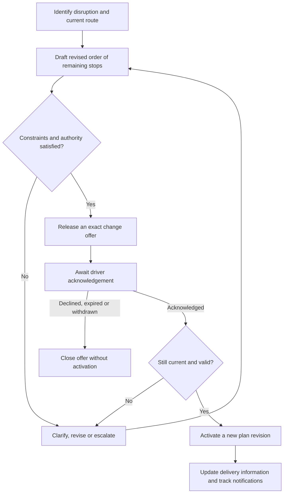

# FT-P01 — Controlled changes to a delivery route in progress

**Status:** Proposed reference process for the hypothetical FruitTrucks client.

**Date:** 3 November 2026.

**Purpose:** A coherent case to model, inspect and evolve in finalized Loom, and to introduce progressively through the campus.

This document owns the proposed process design. Existing company facts remain owned by the [FruitTrucks fact sheet](fruittrucks.md). New policies below are identified as proposals or illustrative fixture choices; they do not silently settle the fact sheet's open questions. This is a system-definition reference, not an implemented DDC process, a generated KnowledgeHub instance or evidence of client acceptance.

## 1. Business purpose and initial boundary

A dispatcher needs to respond to a disruption after a delivery vehicle has left its depot. Another order of the remaining stops could reduce disruption, but drivers must not act on missed, obsolete or ambiguous instructions. Customer service also needs an understandable effective plan.

**Desired outcome:** the dispatcher and assigned driver share one established delivery plan, with an attributable reason for its change, acknowledgement of the exact instruction, and visible communication status.

The first scope changes only the order of **unserved stops** and the resulting delivery estimates. Driver, vehicle, cargo, customer orders and completed deliveries remain unchanged. Vehicle replacement, transferring goods, adding orders and assigning another driver are later extensions.

The application being designed is FruitTrucks' **Dispatch & Delivery Coordination (DDC)** system. Loom represents that design. Workbench helps people develop it. KnowledgeHub stores governed definitions and evidence; it does not dispatch vehicles or execute the business process.

## 2. Sources and decision status

| Basis | Status and use |
| --- | --- |
| Fact sheet §8: missed route-change instructions and poor delivery visibility | Existing problem and intended capability. |
| Fact sheet R8 and [operations manual](../../sessions/session-03/data/operations-manual.md) | Existing requirement: a route change after departure is valid only once the driver acknowledges it. |
| [Dispatcher interview](../../sessions/session-03/data/dispatcher-interview.md) | Reported practice without prior acknowledgement. Preserve its disagreement with prescribed behaviour; it is not an approved replacement policy. |
| Fact sheet R6 and [customer agreement](../../sessions/session-03/data/customer-agreement.md) | Existing delivery commitments. Contradictory ERP window values remain a clarification case. |
| Fact sheet Q1 | Existing target: a route change reaches the driver's phone within 60 seconds. This measures instruction delivery, not driver acknowledgement. |
| Fact sheet Q3 | Existing offline concern. This does not define an offline route-change acceptance protocol. |
| Exact offer binding, stale guards, expiry and retry rules below | Proposed design decisions for this reference process. |
| Five-minute offer validity | Proposed teaching-fixture value, not an established FruitTrucks policy. |

Use source status and provenance to distinguish client requirements, reported practice, design decisions, assumptions and open questions. Exact quotations can establish what a source says; interpretation and policy resolution still need review.

## 3. Actors and responsibility boundaries

| Participant | Responsibility |
| --- | --- |
| Dispatcher | Prepare and release an ordinary change within current authority; manage unresolved exceptions. |
| Assigned driver | Examine and acknowledge or decline the exact instruction addressed to them. |
| Operations manager | Decide exceptional cases outside ordinary dispatcher authority; thresholds remain a client decision. |
| Customer service | Inspect the effective plan, revised estimates and outstanding communication problems. |
| DDC application | Check changes, preserve versions, coordinate acknowledgement and activation, and report outcomes honestly. |
| Existing systems | Supply customer/location information, operational observations, routing estimates and message delivery through defined integration boundaries. |

Candidate context responsibilities are **Dispatch** for the change process and effective plan, **Delivery Execution** for driver interaction and execution progress, and **Customer Communication** for delivery information and notification outcomes. Route Planning supplies the original plan; Fleet & Cold Chain and the existing ERP supply relevant information. These are modelling responsibilities, not an instruction to deploy separate services.

Ordinary dispatcher authority over this limited stop-order change is a proposed baseline. It does not settle G1, the wider question of reassignment authority, or permit bypassing driver acknowledgement.

## 4. Ubiquitous language

| Term | Meaning within this process |
| --- | --- |
| Route | One vehicle's ordered delivery stops for an operating day. It does not mean a road segment or recurring sales territory here. |
| Effective plan revision | The established stop sequence used by execution and customer-facing information. |
| Served stop | A stop whose completion is established in route execution. It cannot be reintroduced as unserved by this process. |
| Route change request | The identified case for considering a change, retaining its reason and proposal history. |
| Candidate plan | A proposed order of unserved stops and associated estimates, based on identified inputs. |
| Change offer | The exact candidate revision released to the assigned driver, with an expiry and captured starting state. |
| Driver acknowledgement | An attributable response to that specific offer, distinct from transport delivery or a dispatcher reading a message. |
| Activation | Establishing the candidate as the new effective plan after all applicable checks. Acknowledgement is necessary but not sufficient. |
| Communication job | A separately tracked request to communicate information about an established change. Creating a job is not proof of delivery. |

## 5. Main journey

The dispatcher learns that a forthcoming stop cannot proceed at its planned time. They inspect the current route and propose a different order for its remaining stops. DDC shows the original and candidate plans, their inputs and estimated impact.

After the ordinary checks pass, the dispatcher releases the exact offer. The assigned driver receives it, examines the change and acknowledges or declines. DDC rechecks that the offer remains current and admissible before activating a new plan revision. Customer service sees the established result and any outstanding communications.

| Step | Behaviour and observable result |
| --- | --- |
| FT-STEP-01 — Understand | Open the effective plan, remaining stops and execution progress. Retain the disruption reason and supporting information. |
| FT-STEP-02 — Prepare | Propose a new sequence of the same unserved stops. Show the original/candidate sequences, estimated arrivals and affected commitments. |
| FT-STEP-03 — Check | Check current authority, unchanged assignment, served-stop protection, stop completeness and applicable delivery constraints. Expose contradictory or insufficient information. |
| FT-STEP-04 — Release | Retain the candidate, starting plan, dispatcher, reason and expiry. Send that specific offer to the assigned driver. |
| FT-STEP-05 — Acknowledge | Receive acknowledgement or decline of the exact offer. Keep sent, delivered and acknowledged states distinguishable. |
| FT-STEP-06 — Activate | Recheck the offer, current plan, assignment and relevant execution progress. Record one activation and a new effective plan revision, or preserve the candidate with an explicit refusal. |
| FT-STEP-07 — Communicate | Publish the established plan to execution and customer service. Create traceable communication jobs where required, with visible pending/failure states. |

Operational success means that activation is established, the effective plan is available to its consumers, and required communication work is durably registered and inspectable. It does not mean every recipient has received a message. Notification delivery is tracked separately.

### Worked example

The following names, identifiers, times and estimates are **invented fixture data**, not additional company facts. All times are local to the route's operating day.

Route `FT-ROUTE-EX01` carries fresh produce and is already under way. Mercado Centro has received its delivery. The next supermarket reports a temporary unloading delay, so the dispatcher proposes serving Frutería Plaza first. The same driver and vehicle retain the same orders and cargo.

| Stop | Effective plan revision 7 | Candidate sequence | Candidate arrival | Fixture delivery window |
| --- | --- | --- | --- | --- |
| Mercado Centro | 1 — served at 08:55 | Preserved as served | Already completed | Not relevant to the remaining plan |
| Supermercado Norte | 2 | 3 | 10:00 | 09:45–10:15 |
| Frutería Plaza | 3 | 2 | 09:25 | 09:15–09:45 |
| Supermercado Parque | 4 | 4 | 10:25 | 10:15–10:45 |

At 09:05, the dispatcher releases offer `FT-OFFER-EX01`, revision 1, against effective plan revision 7. Its illustrative expiry is 09:10. The assigned driver receives it at 09:05:30 and acknowledges that exact offer at 09:07. With the plan, assignment and relevant progress still matching, DDC establishes plan revision 8 and records the resulting communication work.

The 30-second instruction delivery satisfies the example's 60-second delivery target; the two-minute acknowledgement is a separate observation. A repeat of the same activation operation returns the original revision-8 result. If Norte had instead become served before activation, DDC would refuse this candidate and require replanning. These are separate scenario branches, not events that all occur in one run.

## 6. Business rules and proposed invariants

| ID | Rule | Basis |
| --- | --- | --- |
| FT-REQ-ACK | No activation before the assigned driver acknowledges. | Existing R8, refined by the exact-offer design below. |
| FT-INV-EXACT | Acknowledgement names one exact offer revision. Changed content requires fresh acknowledgement. | Proposed design. |
| FT-INV-REMAINING | The candidate contains each unserved stop exactly once, introduces no new stops, and preserves completed deliveries. | First-process scope and proposed integrity rule. |
| FT-INV-CURRENT | The expected effective plan, assignment and relevant served-stop state still match at activation. | Proposed consistency rule. |
| FT-INV-AUTHORITY | Current dispatcher authority governs release; only the currently assigned driver may acknowledge. | Proposed authority rule. |
| FT-INV-SINGLE-OFFER | At most one released, actionable offer exists for a route. Replacing it explicitly withdraws or supersedes the earlier offer. | Proposed simplification. |
| FT-INV-EXPIRY | An expired, declined, withdrawn or superseded offer cannot activate. Expiry is never acceptance. | Proposed temporal rule. |
| FT-INV-RETRY | Repeating the same logical operation recovers its original outcome; it does not activate another plan revision or create another logical communication job. | Proposed reliability rule. |
| FT-REQ-COMMITMENTS | Applicable delivery commitments remain visible; a known violation or unresolved conflict leaves the ordinary path for clarification or exception handling. | Existing delivery concern; proposed admission behaviour. |
| FT-REQ-HISTORY | Retain the prior and replacement plans, exact offer, actors, acknowledgement, reason and established result. | Proposed audit and explanation contract. |

Estimates are not delivery guarantees. An ETA calculation passing a check does not prove that the real delivery will meet its window. Missing or conflicting constraints must remain explicit.

## 7. Time, interruption and alternative paths

For the authored teaching fixture, propose an offer expiry **five minutes after dispatcher release**. Retries do not extend that deadline. The production duration remains a client policy decision. The existing 60-second instruction-delivery target is a different measure.

| Situation | Required response |
| --- | --- |
| Driver offline or message undelivered | Keep delivery/acknowledgement pending and visible. Do not activate merely because an offer was sent. |
| Driver declines | Close that offer without activation and return the case for dispatcher attention. |
| Offer expires | Record expiry, alert the dispatcher and reject late acknowledgement. |
| Relevant plan/progress changes | Refuse the old candidate. Retain it for explanation and prepare a fresh offer where appropriate. A GPS observation alone does not necessarily invalidate the offer. |
| Candidate content changes | Withdraw/supersede the released offer and obtain acknowledgement of its replacement. |
| Activation response is lost | Show an unresolved outcome until the original operation result can be established. Do not infer failure or submit different intent blindly. |
| Customer communication fails | Preserve the effective plan; retain a visible retry or attention state for communication. |
| Delivery-window sources disagree | Show the conflicting sources and obtain a traceable clarification before using an unresolved constraint in the ordinary path. |

The application retaining the previous effective plan does not resolve the physical disruption. The dispatcher still manages the situation. Manual telephone acknowledgement, emergency overrides and alternative authority are not implicitly added to this reference process.

## 8. Domain structure, lifecycle and information

A candidate **Route aggregate** protects the effective plan, relevant execution progress and current actionable offer. Its root is a Route entity. RouteChangeRequest and RouteChangeOffer have explicit identities; an immutable candidate describes the proposed sequence. The request retains the case identity across reconsideration while released offers remain attributable and distinguishable.

The lifecycle below belongs to an individual offer:

> Draft → Awaiting acknowledgement → Activated

Alternative terminal outcomes are Declined, Expired, Withdrawn and Superseded. A revised offer is a fresh candidate revision; it does not erase the earlier content or inherit its acknowledgement. The encompassing process can loop back to planning without rewriting closed offer history.

| Logical record | Information to retain |
| --- | --- |
| Route/effective plan | Route identity, operating day, assignment, effective plan revision, ordered stops and relevant execution progress. |
| Change request | Case identity, route reference, disruption reason, actor and proposal history. |
| Offer | Offer identity/revision, request reference, candidate plan, expected plan/progress, released actor/time, expiry and outcome. |
| Acknowledgement | Response identity, assigned driver, exact offer reference, response/time and attributable source. |
| Activation result | Original operation identity, established outcome, resulting plan revision and history references. |
| Communication job | Identity, activated plan reference, intended recipient/purpose, channel decision where configured, attempts and outcome. |

These are logical definitions rather than SQL table instructions. DDC's operational plan/offer revisions and KnowledgeHub's revisions of these definitions are separate versioning domains.

Candidate commands include prepare/revise a candidate, release an offer, acknowledge, decline, withdraw and resolve an operation outcome. Queries include the effective plan, offer comparison, outstanding responses and communication status. Reuse the existing event names RouteChangeAcknowledged and RouteChanged; offer-released, declined, expired and communication-outcome events are proposed additions to the DDC design, not new ontology built-ins.

## 9. Interaction and integrations

| Surface | What the person can understand and do |
| --- | --- |
| Dispatcher route view | Inspect the effective plan, progress, disruption and sources. |
| Change comparison | Compare original/candidate sequences, estimated impact, constraint issues and exact release scope. |
| Driver instruction | Read one identified offer, its changes and validity; acknowledge or decline it. |
| Change outcome view | Distinguish pending delivery, pending acknowledgement, refusal, established activation and unresolved operation outcome. |
| Customer-service view | Read the effective version and estimates, with outstanding communication problems clearly separated. |

ERP/customer records, operational observations, routing estimates and messaging each need declared authority, freshness, failure and translation contracts. Existing systems remain in place; the process does not introduce direct ERP modification or equate messaging delivery with driver acceptance.

After activation, customer information and communication jobs refer to the activated plan revision. Jobs have stable logical identities across retries. External delivery guarantees depend on the chosen provider contract; one logical job is not a promise of exactly-once physical message delivery.

## 10. KnowledgeHub ontology mapping

The mapping uses the [current catalogue vocabulary](../../../knowledgehub/src/ontology/catalogue.json). FruitTrucks concepts are system definitions expressed through generic types; they are not additions to the built-in ontology.

| Reference-case concern | Ontology representation |
| --- | --- |
| Purpose and value | BusinessGoal, DesiredOutcome, BusinessCapability. |
| People and responsibility | Actor, BusinessRole, BoundedContext. |
| Human progression and useful increments | Journey, JourneyStep, UserStory, StoryMap, StoryPlacement, OutcomeCut. |
| Coordinated business process | ProcessDefinition, ProcessStep, Timer and explicit guarded branches/loops. |
| Route, request, offer and acknowledgement definitions | AggregateDefinition, EntityType, ValueObjectType. |
| Offer states and transitions | LifecycleDefinition whose subject is the particular offer EntityType definition, plus State and Transition. |
| Requests, reads and published facts | UseCase, CommandDefinition, QueryDefinition, EventDefinition. |
| Information | DataSchema, FieldDefinition, DataType, including appropriate reference, enumeration, timestamp and duration definitions. |
| Visible behaviour | ScreenDefinition, ViewState, Interaction, ActionBinding, DataBinding. |
| Promises, design choices and uncertainty | Requirement, BusinessRule, Invariant, DesignDecision, OpenQuestion. |
| Examples and future verification | Scenario, AcceptanceCriterion, TestCase; TestRun and observed evidence only after actual execution. |
| Source grounding and exact history | Source/provenance kernel, original artifacts, anchors, interpretation records, exact revisions and model baselines. |

One representative trace is:

1. A driver-screen Interaction **issues** an acknowledgement CommandDefinition.
2. The command is **handledBy** a UseCase that **satisfies** FT-REQ-ACK.
3. A Scenario **illustrates** that Requirement; a future TestCase **checks** it and the applicable Invariant.
4. The Route AggregateDefinition **protects** its Invariants and **hasRoot** its Route EntityType.
5. A UserStory **supportsStep** a JourneyStep; a Requirement **formalises** the applicable story or desired outcome.

Every relationship must use its declared endpoints and exact references. Modelled rule text and timers are definitions; storing or validating them does not execute them. This source-level mapping has not yet been instantiated and validated as a complete native model.

## 11. Acceptance scenarios

These are authored examples, not records of successful execution.

| ID | Given / When | Expected result and preserved state |
| --- | --- | --- |
| FT-S01 — Normal | A permitted dispatcher releases a feasible offer; the assigned driver acknowledges it before expiry, and guards still match. | One new effective plan revision is established, history is retained and communication work is registered. |
| FT-S02 — No acknowledgement | An offer is delivered but the driver does not acknowledge before expiry. | No activation; delivery and expiry are distinguishable, and dispatcher attention is visible. |
| FT-S03 — Completed stop | A relevant stop becomes served after the candidate was prepared. | The obsolete offer cannot reintroduce it; refusal preserves the candidate and requires revised planning. |
| FT-S04 — Old offer | A driver acknowledges an expired, withdrawn or superseded offer. | No activation; the old response remains attributable and the current offer is not implicitly accepted. |
| FT-S05 — Lost result/retry | The activation response is lost and the same logical operation is retried or queried. | Recover the original outcome; do not create a second activation or logical communication job. |
| FT-S06 — Wrong authority | A different driver acknowledges, or dispatcher authority no longer permits release. | Refuse the operation and preserve the effective plan and candidate history. |
| FT-S07 — Communication failure | Activation is established but a notification attempt fails. | Keep the plan established and the communication outcome visible, with a defined retry/attention path. |
| FT-S08 — Conflicting window | Relevant customer-agreement and ERP values disagree. | Preserve both references and the unresolved constraint; no invented consensus or misleading feasibility result. |
| FT-S09 — Changed candidate | The dispatcher changes a released stop sequence. | The earlier offer/acknowledgement cannot authorize the replacement; fresh acknowledgement is required. |

At modelling time, the manual/interview disagreement supplies a further interpretation exercise: preserve prescribed behaviour and reported practice separately and identify the source and authority of any resolution.

## 12. Presentation in finalized Loom

| Loom view | Reference-case content |
| --- | --- |
| Context map | Dispatch, Delivery Execution and Customer Communication, with relevant external information dependencies. |
| Model graph | Requirements, route/offer definitions, commands, use cases, invariants and explicit traces. |
| Journey | Dispatcher/driver progression from disruption to established outcome. |
| Lifecycle | Offer states and guarded transitions. |
| Schemas | Logical route, request, offer, acknowledgement and communication records. |
| Hierarchy | Declared ownership and composition of these definitions. |
| Documents | Existing FruitTrucks sources, proposed policies and unresolved questions with their status. |
| History | Revisions and baselines of the design model. Operational examples are separately labelled fixtures or evidence, not fabricated runtime history. |

Loom's engineer may inspect, propose and review a change to the acknowledgement requirement. That changes a system definition; it does not acknowledge a delivery instruction or activate a real route. The engineer's Loom membership and the DDC driver's operational authority remain separate.

## 13. Progressive teaching and unresolved client decisions

Session 4 needs only the actors/outcome, a small journey, the acknowledgement rule and a few scenarios. Later sessions elaborate sourced interpretation, reviewed model evolution, semantic rules, architecture, contracts and controlled change. Workbench onboarding remains inside session 4's first hour; KnowledgeHub installation and its eventual Node.js/command-console access are separate later preparation.

The full reference keeps these questions explicit:

- Ordinary/exceptional dispatcher authority and Operations Manager thresholds.
- The production offer-validity policy and handling of emergencies or manual acknowledgement.
- Customer communication recipients, channels and contact preferences.
- Resolution authority for conflicting contractual and operational window information.
- Acceptable estimate freshness and risk rules when assessing feasible alternatives.
- Identity, trace and retention policies for operational requests and acknowledgements.

Do not turn an open question into a source fact or an authored scenario into observed execution. The eventual reference-model completion evidence should establish source coverage, valid typed traces, coherent baseline/revision inspection and separately recorded human review. Executing the DDC process requires its own implementation and operational verification.
