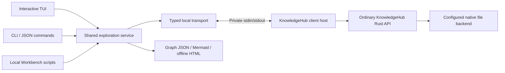

# Design

## Context

See [proposal.md](proposal.md) for motivation, scope and source traceability. The checked-out repository contains one Rust library crate, the `knowledgehub-model` authoring binary in `src/bin/knowledgehub-model.rs`, its orchestration in `src/model_authoring.rs`, and source/plan/coverage fixtures under `examples/fixtures/`. There is no terminal browser, Bun package or generic persistent exploration host in this repository.

`design/typed-ontology-api.md`, `src/ontology/api.rs`, `src/ontology/navigation.rs`, `src/ontology/neighbours/api.rs` and `src/ontology/types.rs` expose the needed native operations. The current contract is library 0.10.0, catalogue-3 and record/request codecs /3 with native files/4. `query`, neighbours, literal search, bounded traversal, exact record/artifact reads, predecessor references and named-baseline comparison already have semantic owners. The terminal consumes these rather than implementing another graph engine or reading native storage JSON.

Native history C8 is now implemented and technically verified, with 20/20 tasks complete. [The delivered guide](../../../design/native-model-history.md), `src/ontology/history/{api,types}.rs` and [handoff evidence](../../../delivery/evidence/native-history/20261104-apply/README.md) supply the permission, owned contracts, limits and observed boundary. This planning revision aligns the future consumer with that delivery; no terminal code or acceptance is established here.

Modelarium has a separate application-owned host, TypeScript wire mapping, identity/admission machinery, SQL registry and client. It demonstrates a possible process boundary, but its private protocol is not a KnowledgeHub standard. Reading it during planning does not make it a build dependency or authorise any changes there.

`delivery/slice-plan.md` says the initial library did not require a product CLI. This is an additive consumer slice TC-SL-01, not a rewrite of that historical scope. Existing authoring commands and their publication/recovery contracts remain unchanged. Several completed current-contract changes are not archived; use their delivered code and documented /3 contract rather than interpreting their archival status as missing implementation.

## Goals / Non-Goals

**Goals:**

- One generic query/inspection service behind a keyboard browser, individual commands and reusable local TypeScript functions for Workbench scripts.
- A small public-API host boundary with exact owned values, finite work and explicit incompleteness.
- Editable, traceable visuals and a packaged instructor path that works without development tools.
- A generic client demonstrated with FruitTrucks and an unrelated prepared native model.

**Non-Goals:**

- No changes to Modelarium or adoption of its SQL, private admission protocol or configuration names.
- No writable terminal operations, new ontology semantics, native addon, HTTP listener, remote SDK, backend migration or automatic diagram import.
- No automatic discovery by walking storage directories; no decoding of native manifests/graph files by TypeScript.
- No operating-system read-only guarantee: the native backend can recover and prepare derived indexes. The guarantee is no semantic publication by this client.
- No live attachment to an already-running application. Independent course copies and quiescent prepared models are the initial deployment boundary.

## Decisions

### 1. Own both executables and a shared exploration layer here

Proposed implementation layout:

```text
src/bin/knowledgehub-client-host.rs
src/terminal_client_host/          # binary-local composition, policy and wire code
clients/terminal/
  package.json, bun.lock           # exact pinned development dependencies
  src/main.ts                     # kh entry point and argument handling
  src/transport/                  # frames, handshake, DTOs and host lifecycle
  src/exploration/                # selection, resolution, views, sources, graph extraction
  src/cli/                        # human and versioned JSON presentation
  src/tui/                        # terminal state, panes, focus and keyboard handling
  src/visualization/              # graph JSON, Mermaid and offline HTML export
  tests/
examples/fixtures/terminal-client/ # portable source, plan, coverage, expected reads
scripts/package_terminal_client.*
design/terminal-client.md          # implementation-time usage and protocol guide
```

The Rust binary remains an additional consumer in the existing crate, with a small path-included support module like the current authoring binary; it does not add terminal types to the library's public exports. The Bun package has its own lockfile and tests and does not make Rust-only consumers install JavaScript dependencies. Keep optional host/runtime changes isolated and preserve the library's default consumer contract.



The host stays alive across TUI actions and local scripted sessions. A one-shot CLI command starts one host and shuts it down after its bounded result. No process-per-record, external daemon, SQL installation or network endpoint is introduced.

Alternatives: a Rust-only TUI would remove the local TypeScript exploration surface requested for Bun/Workbench; a native addon would introduce the compilation/compatibility boundary the user elected to avoid; importing Modelarium's client would violate repository independence. Choose a repository-owned Bun client with a prebuilt Rust host.

### 2. Configure native directories and scopes explicitly

Use a versioned `knowledgehub-client-workspace/1` JSON document with a default alias and entries containing display name, native directory, exact `ModelScope`, stable local actor and explicit `grants`. The host allowlist is `Open`, `Read` and optional `ReadHistory`; a basic exploration entry needs Open/Read, while history disclosure additionally needs ReadHistory. Optional bounded `known_baselines` contain exact handover references for discovery convenience and confer no authority. Paths resolve relative to that document, not cwd. The CLI accepts `--workspace FILE` and `--model ALIAS`. Reject duplicate aliases/unknown fields, absent required grants, unsupported grant names, missing directories and wrong scopes; never create a replacement store. Canonicalise paths and retain directory identity during an open session; detect an unexpected replacement rather than silently opening it.

The trusted local launcher passes the validated workspace path to its own host. The host independently validates it and constructs `Context` with an exhaustive scoped policy permitting only the explicitly configured subset of `Action::Open`, `Action::Read` and `Action::ReadHistory`. Ordinary reads do not imply history permission. Check current authority on calls, continuations, releases and cached disclosures; revoke history without disabling permitted ordinary browsing. Never use an all-allow policy, switch to the original publisher's actor, or grant `OperationResult` to implement history. There is no ordinary wire operation for arbitrary policy/grant creation. Requests select an admitted alias/session; they cannot supply filesystem overrides or change the actor. No global account system is introduced. This is a trusted local operator tool, not a security sandbox against a person who can modify the binary, workspace or model files.

The native store is opened directly through `FileBackend::new(..., FileOptions::native_local()?)` and `KnowledgeHub::open`. Modelarium's hashed-root layout, installation binding and private lease conventions are not adopted. Native locking/recovery remains authoritative. A successful native open is not proof that another product has relinquished its application-level ownership. Document that live Modelarium stores are outside this client's initial operating contract; use a quiescent independent course copy. Never remove lease files to make opening work.

### 3. Add a small explicit read protocol

Use `knowledgehub.client/1` as a new local protocol identity, distinct from Modelarium's protocol. Handshake advertises exact native API/codec/catalogue identities, `knowledgehub-history/1` support and its five history methods, permission requirements, host build identity and finite limits. Package version 0.10.0 alone does not identify history support; an older host without the required native methods is incompatible rather than a reason to fall back to storage parsing or an application audit. Frame each UTF-8 JSON message with a four-byte big-endian length and correlate replies by request ID. Stdout is exclusively protocol; stderr is bounded diagnostics. Reject malformed frames before allocating an unbounded body, unsupported methods, mismatched versions and uncorrelated responses.

Initial limits: 8 MiB/frame; 1 MiB structured page/result; 16 outstanding client requests; at most the library's query page/depth ceilings; 10,000 accumulated subjects and edges per exploration action; 64 KiB source-preview chunks with an explicit larger original-export path. These are proposed bounded defaults, not performance measurements. Allow documented smaller budgets and explicit increases only within implemented hard/native ceilings. Return Capacity with the selected reference if one record or requested projection cannot fit; never silently omit it.

Read method groups are open/info/head, ontology/metadata discovery, exact state/reference reads where necessary, query/continuation, neighbours/preparation/continuation, literal search, traversal/continuation, source/artifact/range reads, the five native history methods in decision 4a, exact-baseline comparison, cursor release and session drain. Map operations to the native API and advertise only implemented methods. Exclude actor-bound operation recovery from this explorer. Full State is a bounded diagnostic/bootstrap operation if needed, not the default for any view or history/baseline discovery. Add a bounded metadata projection over public records when counts/gaps would otherwise require an oversized state response; do not access internal storage directly.

Native DTOs retain tagged variants, exact references, decimal coefficients/exponents and integer strings. Encode actual native unsigned counters/offsets, including publication sequences, affected counts/offsets, work counters and resource limits, as canonical decimal strings; do not transform arbitrary numeric-looking text. Artifact bytes use base64 with native hash/length identity, and ranged reads retain partial/full verification flags. Implement and test these mappings in this repository; no import from Modelarium. Error mapping is exhaustive over the current public error enum, including `HistoryAnchorUnavailable { anchor }`, `HistoryLimit { resource, limit, work }`, policy Unavailable and storage/uncertain failures alongside existing Busy, Denied, Incompatible, Integrity, Capacity, IndexNotReady, InvalidCursor, NotFound and invalid input distinctions. `NotPublishedAt` is a successful anchor-relative lookup outcome, never operation-recovery absence or a transport failure.

Use the installed Rust 1.99.1 and the existing pinned Tokio dependency. A small standard-I/O frame loop can dispatch through a host-owned current-thread Tokio runtime, as the authoring binary already does; retain native bounded blocking jobs. Add Tokio features only if the implemented host needs them. Do not block the JavaScript event loop with terminal reads or synchronous native I/O. No compiler installation, FFI or change to the public executor contract is implied.

On exit, close admission, release owned cursors, drain admitted native work and close the pipe. Cancelled reads remain pending until their response is safely consumed/discarded or the host drains; request slots cannot be reused as though a response never existed. Reopening preserves exact selection/query intent but invalidates process-local cursors. No automatic refresh or semantic retry with changed intent occurs.

### 4. Make exact selection and coverage common to every surface

The shared exploration service owns `(model scope, content selection, publication anchor, filters, selected exact subject)`. Resolve head once when a command/session starts. A snapshot content selection supplies the default history anchor; a baseline content selection remains an exact baseline and uses the separately captured head as its history anchor. `--history-anchor SNAPSHOT` explicitly overrides only publication discovery/lookup and retained-baseline discovery. Never infer a generation snapshot from a baseline label, parent or revision. Every dependent record, source, relationship and visual read carries its content selection; publication inspection labels its separate exact anchor and reads affected historical definitions at the header's original resulting snapshot. `refresh` creates a new navigation state; back/forward retains both selections. Separate selected normative definitions from supporting history and external/unavailable targets.

Keep native projections bounded and cache only by exact selection, reference, projection and current session authority. Release cursors when filters change or a view is abandoned. Do not serve after admission closes. Derived indexes follow native bounded preparation/readiness rules. Statuses are `complete`, `partial` and `failed`; native gaps, source accounting, stored interpretation/review, implementation and acceptance are separate fields, never combined into a fabricated readiness score.

One-shot commands exhaust native continuations within a finite aggregate budget. If that fails, return partial data, reached bounds and a reproducible pinned request. Do not print an opaque continuation as reusable after its host has exited. A TUI or local long-lived script can use its live cursor. The CLI's documented recovery is to rerun the pinned request with narrower filters or permitted larger limits; durable resume tokens are not added in this slice.

### 4a. Consume original publications and bound baseline discovery

Use the delivered public calls, not `operation_result` or a second history index:

| Host/service operation | Native owned request | Native result |
| --- | --- | --- |
| `publication` | `Publication { anchor, operation_id, limits }` | `PublicationResult` with Published header or NotPublishedAt |
| `publications` | `Publications { anchor, limits }` | `HistoryPage` of headers, descending accepted sequence |
| `publication_affected` | `PublicationAffected { anchor, operation_id, limits }` | `HistoryPage` with published flag, total, offset and ordered references |
| `continue_history` | original `HistoryRequest::Publications` or `::Affected`, opaque token | next typed page at the same anchor |
| `release_history` | reader context and opaque token | explicit release outcome |

Preserve all original header fields: scope, operation ID, actor, fingerprint version/fingerprint, previous/resulting heads and sequence, plus affected_count. Keep the reader's current identity separate from original attribution. A header is a projection; only a fully collected exact affected vector reconstructs a receipt. Preserve repetitions, zero-affected publications, published=false, offsets, `complete`, `initial_boundary`, `stopped_by` and native work. NotPublishedAt proves only non-membership at the verified anchor; later-than-anchor operations have that outcome too. Unknown/foreign anchors, denial, unavailable policy/storage and corrupt bindings never become empty complete history.

Native limits are validated without clamping:

| `HistoryLimits` field | Native default | Native hard maximum |
| --- | ---: | ---: |
| items | 100 | 1,000 |
| nodes | 256 | 8,192 |
| storage_bytes | 16 MiB | 128 MiB |
| output_bytes | 256 KiB | 4 MiB |

The native `HistoryWork.output_bytes` counts its compact owned JSON, not the terminal wire/CLI envelope after decimal-string mapping. Preserve native work counters and independently measure the complete wire/output envelope against the 1 MiB default structured-result and 8 MiB frame limits. Explicit increases must fit both native and transport ceilings; oversize values fail without truncation or silent limit changes. Initially bound one exploration action to 64 native history data-read calls and 10,000 accumulated publication headers/affected references, in addition to existing subject/edge and output budgets; bounded cursor cleanup/drain remains separately required. Sum actual native node/storage/encoded/decoded work across calls and report reached consumer/native bounds separately. These are proposed consumer guards, not changes to native defaults or performance claims.

History cursors share the native 64-entry query/neighbour/impact pool and 30-minute idle expiry. Tokens bind actor, scope, anchor, kind/operation and every limit; changed limits require a new query, not continuation. Release abandoned history cursors through `release_history` while authority permits, and drain the handle on session close if revocation prevents release. After process loss, expiry or invalidation, restart at the retained anchor with explicit fresh-query status; never switch to latest. One-shot commands return reproducible pinned intent, completed coverage and reached bounds, not dead tokens. For history without native filters, recovery uses permitted larger aggregate limits, a known-operation lookup, or a live paged session rather than invented actor/time filters.

Keep three baseline discovery sources explicit: (1) a bounded typed query of baseline records selected at the captured snapshot, (2) validated exact `known_baselines` from configuration/handover, and (3) an opt-in `baselines --retained` scan composing native publications, affected pages and exact record reads at each publication's resulting head. The third requires ReadHistory; it identifies Baseline records by native kind and deduplicates exact references without inferring kinds from names. It is complete only after accepted ancestry, all required affected ranges and candidate reads are exhausted within the action budgets. Otherwise report partial or failed coverage and retain the anchor. Ordinary listing makes no claim to enumerate superseded baselines. There is no new native retained-baseline catalogue.

Compare known A/B through existing `compare(context, before, after)` and identify its two explicit baseline operands independently of the navigation content selection. The native method has no snapshot-anchor parameter: do not claim that a history anchor constrains comparison, substitute an operand from global selection, or imply a generic snapshot diff. If availability at a particular snapshot is claimed, establish that separately with an ordinary exact read. Comparison returns an unpaged vector; enforce documented consumer response limits and fail explicitly for an indivisible oversized result without claiming native paged work counters or adding another diff engine. Record predecessors, baseline parents, native publication ancestry and terminal back/forward navigation stay separate. Publication sequence supplies no timestamp, business execution, review or human acceptance.

Cold pack/index costs and errors remain native. History requests never invoke an automatic full-pack repair; report IndexNotReady for explicit supported maintenance outside the exploration host's history path. Ordinary query/neighbour preparation keeps its existing bounded contract. Do not move a history scan/preparation into opening or a cache to conceal its cost.

### 5. Offer a stable command language and JSON envelope

The executable is `kh`; development uses `bun run src/main.ts` from `clients/terminal`. Opening without a command on a TTY starts the browser; non-TTY use prints help or requires a command, never an invisible prompt. Explicit `browse` remains available.

```text
kh --workspace course/workspace.json models
kh --workspace course/workspace.json --model fruittrucks info --json
kh ... types --json
kh ... type TYPE-REFERENCE --json
kh ... list --type Requirement --json
kh ... tree --view context --json
kh ... show FT-REQ-ACK --json
kh ... links FT-REQ-ACK --direction incoming --category association --json
kh ... search "acknowledgement" --type Requirement --json
kh ... source FT-REQ-ACK --json
kh ... history FT-REQ-ACK --json
kh ... publications --history-anchor SNAPSHOT --json
kh ... publication OPERATION-ID --history-anchor SNAPSHOT --json
kh ... publication OPERATION-ID --affected --history-anchor SNAPSHOT --json
kh ... gaps --json
kh ... baselines --json
kh ... baselines --retained --history-anchor SNAPSHOT --json
kh ... compare BASELINE-A-REFERENCE BASELINE-B-REFERENCE --json
kh ... diagram FT-REQ-ACK --depth 2 --format mermaid --out explanation.mmd
kh ... diagram FT-REQ-ACK --depth 2 --format html --out explanation.html
kh ... browse
```

Examples use proposed grammar and fixture shortcuts, not currently available commands. `--snapshot TOKEN` or `--baseline EXACT-REF` are mutually exclusive global selection options. Exact references have a documented lossless JSON/argument encoding; native IDs/revisions are opaque. Friendly type names and source IDs are conveniences resolved against permitted selected records; collisions return candidates, including colliding type definitions. No implicit first match.

`history SUBJECT` follows exact record predecessors; `publications` discovers native accepted headers; `publication OPERATION-ID` resolves one header and `--affected` pages its original vector. The result carries the exact publication anchor even when content selection is a baseline. `baselines` labels selected/handover discovery coverage; `--retained` explicitly opts into the bounded history composition in decision 4a. Read-only users lacking ReadHistory receive denial for publication/retained-discovery commands while ordinary inspection and known A/B comparison remain available under their existing permissions.

JSON uses `knowledgehub-exploration/1` with status, exact model/content selection, publication anchor when used, command intent, data, coverage, warnings and typed error. It contains no ANSI controls or progress copy. Exit outcomes are 0 complete, 2 invalid usage/request, 3 partial result, 4 denied, 5 ambiguous/not found, 6 operational/compatibility/native-integrity failure, 130 user cancellation. A complete empty search and an explicit NotPublishedAt lookup are success with their distinct outcomes; a direct missing subject is not. Exhausted work/output limits produce partial/reached-bound outcomes (exit 3), including a typed HistoryLimit when no item fits; an unavailable history anchor or unverifiable storage is an operational failure (exit 6), not absence. File/binary output commands write to an explicit destination; conflicting `--json`/raw-output modes fail clearly. JSON failure envelopes stay on stdout, safe human diagnostics on stderr.

No embedded JavaScript eval, shell, general SQL query or natural-language interpretation is part of the command language. Workbench scripts import the local exploration functions or call `--json`; the actual agent supplies interpretation outside the deterministic client.

### 6. Derive navigable trees from the registered model

Use one exploration state behind a left discovery pane, centre inspector and right/bottom links/source pane. A compact terminal stacks panes instead of losing controls. Start with a small terminal renderer using Bun's Node-compatible TTY/readline interfaces and explicit state transitions; avoid a browser stack or a second application framework. Pin any rendering helper actually needed and verify its compiled behaviour.

Bindings: arrows/j/k move; Enter opens/follows; Space expands a group; Tab changes pane; `/` searches; `f` filters; Alt-Left/Alt-Right go back/forward; `s` opens source; `l` opens links; `v` exports a view; `r` explicitly refreshes; `?` shows help; Escape cancels the current action; `q` exits from navigation. Provide textual alternatives for terminals that do not emit Alt bindings. Search text input owns its keys until submitted/cancelled. No action requires a mouse. Plain/no-colour mode and resize preserve the exact selection.

Provide a keyboard-reachable publication pane with original publisher, operation, native sequence, previous/resulting heads, affected count/pages, pinned anchor and coverage. Opening an affected reference uses its original publication snapshot and keeps the return path. Label this separately from predecessor lineage and back/forward navigation. Show history denial independently while keeping permitted ordinary panes usable; revocation invalidates cached publication and retained-baseline data. No publication timestamp or review state is inferred.

By-type grouping enumerates exact registered types and permitted instances, including governed subtype intent. By-context and by-journey views use explicit schema-declared memberships and recorded reference occurrences; by-source uses exact provenance and narrative bindings as a separate evidence view. Known catalogue structural fields/signatures can select view adapters by exact registered identity/role, never by an application label. Unknown extensions still have complete generic type/property/reference inspection; unsupported specialized hierarchy is explicit. Show unassigned definitions and virtual grouping labels. Never infer ownership from folder/name similarity or ordinary graph reachability.

Expand lazily through native query/neighbours with finite limits. Modelled containment, association and ordered journey/lifecycle structure have separate labels. Shared targets appear as shortcuts to the same exact subject; cycles get a revisit marker, not recursive expansion. Preserve order only when explicitly modelled; ordinary listing order is labelled as such. Generic inspection handles kernel subjects, assertions and nested tagged values, with exact source-range reads for narrative fields. Sanitize terminal control bytes for display while retaining exact original export.

### 7. Extract once, render several faithful derived views

Create a bounded graph DTO `knowledgehub-view/1` from native query/neighbours/traversal. It includes exact selection, subjects, assertion/property occurrence identities, source bindings, selected/supporting/external status, requested scope, reached limits, unresolved inputs and explicit gaps. UI/Workbench presentation groups never become native edges.

Mandatory views are a generic relationship graph and journey/lifecycle projections when the model explicitly supplies their structure. The extractor rejects unsupported mappings or emits a clearly partial view with missing structure. It never creates a business transition from `satisfies`, orders steps alphabetically as a process, or treats a proposed timer as executed behaviour. Stable output IDs derive from exact qualified references and occurrence IDs; do not use display names as keys. Parallel origins remain in JSON and manifest even if visual labels are grouped.

Generate sorted graph JSON, editable Mermaid and a manifest from that single DTO. HTML embeds the same data and a pinned bundled renderer, with no CDN, local server or automatic remote resource loading. Include selection/coverage banner, legend, zoom/pan and a textual inspector linking nodes/edges to their included references and source metadata. Escape labels and embedded data so sources cannot execute code or inject diagram statements. The preview is a derived inspection artifact, not a browser authoring app.

Resolve explicit output paths, forbid paths inside native stores/protected historical locations and refuse existing artifacts unless replacement is explicit. No model publication or RepresentationBinding creation follows export. Outputs are inspection packages; they are not native interchange/backup bundles. Agent-generated follow-up diagrams remain external interpretations unless separately imported and reviewed through future authorised work.

### 8. Ship executable packages and prepared working copies

Maintainers compile `knowledgehub-client-host` with the existing Rust toolchain and use Bun's compiled-executable packaging for `kh`; ship them together with offline assets and a checksum/version/provenance manifest. This avoids requiring Bun on the presentation machine. Development can still run the TypeScript sources using Bun. Package tests must verify compiled TUI raw input, host path resolution, offline assets and graceful exit; bundling success alone is insufficient.

First verified package target: macOS arm64/local APFS. The library's other declared target, Linux x86_64/local ext4, needs its own native distribution run before being called classroom-ready. Do not imply Windows, x86 macOS, network/cloud-sync filesystems or a new native profile. Existing Linux/fixture-copy gates keep their own status.

Use explicit fixture preparation through `knowledgehub-model`/ordinary API operations before packaging; the read-only explorer cannot create its fixtures. Store portable source/plan/coverage inputs in this repo. FruitTrucks uses the campus controlled-route-change reference as authored source input, copied with origin/digest and requirement/proposal distinctions retained. Package only a small coherent slice: acknowledgement requirement, command/use case, normal/refusal scenarios, journey, route/offer definitions, explicit offer lifecycle, sources and open questions. Five-minute validity remains a hypothetical teaching decision. No browser mock JSON is imported as native data and no operational route dispatch is executed.

Include A/B baselines and a semantic successor authored before packaging, enough for exact history and comparison. Preserve an explicit handover containing exact baseline references, original publisher A, operation IDs, heads/fingerprints and affected counts. Packaged workspace actor B has explicit Open/Read/ReadHistory grants; a companion Open/Read-only configuration exercises denial without granting mutation recovery. Known handover IDs remain useful even if retained discovery reaches a bound. Use a small equipment-reservation fixture or a reduced current fixture as an unrelated vocabulary check; do not ship the large Memento run or assume ignored `target/` outputs exist. Each prepared native directory has exact scope, checksums, expected reads and source inventory. Copy only quiescent stores into new writable workspaces; retain masters unchanged. Package sample configuration with relative paths. No course source checkout, compiler, native mutation or learner prework is needed at presentation time.

Provide an offline 15–20 minute instructor walkthrough: open FruitTrucks → browse by type/context → select acknowledgement requirement → follow actual incoming satisfies/illustrates links → inspect exact source and proposal status → query the same selected definition with CLI JSON → inspect original A publications as B, page affected references and discover pinned accepted history → inspect/compare A/B with discovery coverage → export/render a bounded diagram → switch to the unrelated model. Record observed behaviour and exact artifacts separately from human teaching/meaning acceptance.

### 9. Verify observable outcomes in dependency order

| Demonstrable increment | Required evidence |
| --- | --- |
| Open and inspect | Native disposable Hub, trusted policy, compatible handshake, exact tagged data, no semantic writes and explicit opening failures. |
| CLI exploration | Typed queries, directions/categories, ambiguity, exact sources/lineage, original publications and affected pages as B, baseline discovery coverage, exact A/B comparison and finite JSON outcomes. |
| Interactive exploration | Real PTY keyboard/resize/back/source/export path, denial/disconnection/capacity recovery and no false empty results. |
| Visual explanation | Same native graph in JSON/Mermaid/HTML; actual offline browser rendering; exact IDs and edge origins; no invented process structure. |
| Course distribution | Relocated compiled package, empty developer-tool PATH, no network, fresh independent copies, observed instructor walkthrough and unrelated-model exploration. |

Native tests use current disposable /3 fixtures, not repository `hub/` or `old_hub/`. Assert semantic head/records/source bytes/receipts unchanged by exploration, allowing expected operational lock/index/recovery files. Fault-injection transport tests distinguish simulated process failures from real library runs. Record target and toolchain. Run existing meaningful Rust authoring/navigation tests and static checks; no change to Modelarium tests or evidence is required.

Extend each fixture's native/CLI/TUI/package checks to reader B inspecting pre-consumer publications by A, ordinary-read-only denial, history revocation/policy failure, preserved original scalars and affected order, later-than-anchor non-membership, initial no-receipt boundary, explicit resource/integrity/index-readiness errors, and cursor intent/capacity/expiry/restart. Assert pinned discovery and exact A/B sources before/after append, reopen and supported packing. A superseded baseline omitted by a selected-record query must remain available by known exact reference and discoverable only within explicit retained-search coverage. Native C8 evidence is a prerequisite; it does not establish these future host, PTY or distribution checks.

## Risks / Trade-offs

- **Two maintained process integrations can drift** → Keep this protocol independently versioned, thin and contract-tested against the public Rust API. Do not retrofit or migrate Modelarium as part of this slice.
- **A tree can imply false ownership or sequence** → Label virtual groups, retain exact graph origins and use only declared structure for specialized diagrams.
- **Large models or narratives exceed UI/transport capacity** → Bounded native requests, lazy panes, range reads, explicit partial/capacity states and no whole-model default.
- **A cursor dies with a one-shot host** → Consume within budget or return reproducible pinned intent; reserve live continuation for long-lived sessions.
- **Native history is mistaken for a baseline catalogue or recovery grant** → Use the delivered current-authority API, label selected/handover/retained discovery coverage, keep original attribution and exclude actor-bound recovery/impersonation.
- **A preview suggests completeness or client approval** → Keep bounds, gaps, source status and derived-view labels visible in every format.
- **Precompiled packages differ by target or terminal** → Execute the compiled package on each claimed target and through real PTY/browser paths; report pending targets independently.
- **Read-only is mistaken for side-effect-free filesystem access** → Explain native recovery/index writes and use independent writable course copies; never claim OS read-only support.
- **Private product ownership is mistaken for native lock compatibility** → Exclude live Modelarium attachment; neither reuse nor bypass its private leases. Preserve the ordinary native contract and require a quiescent independent model.

## Migration Plan

This is additive. After implementation authorisation, introduce the new host and local Bun package, then layer CLI, TUI, exports and prepared distributions in the task order. Existing public library contracts, authoring binary, source inputs, canonical/historical Hubs and Modelarium remain unchanged. Documentation must distinguish the new explorer from the existing authoring workflow. Rollback removes the new package/executables and generated inspection artifacts; it requires no model conversion, reset or native history rewrite.

## Open Questions

- Where should verified binary archives be published or handed to instructors? Local packaging/evidence is in scope; external publication needs a separate explicit instruction.
- Which signing/notarisation identity and institutional distribution channel will be used for wider macOS delivery? This does not block an executed local package and classroom rehearsal, but its status must remain explicit.
