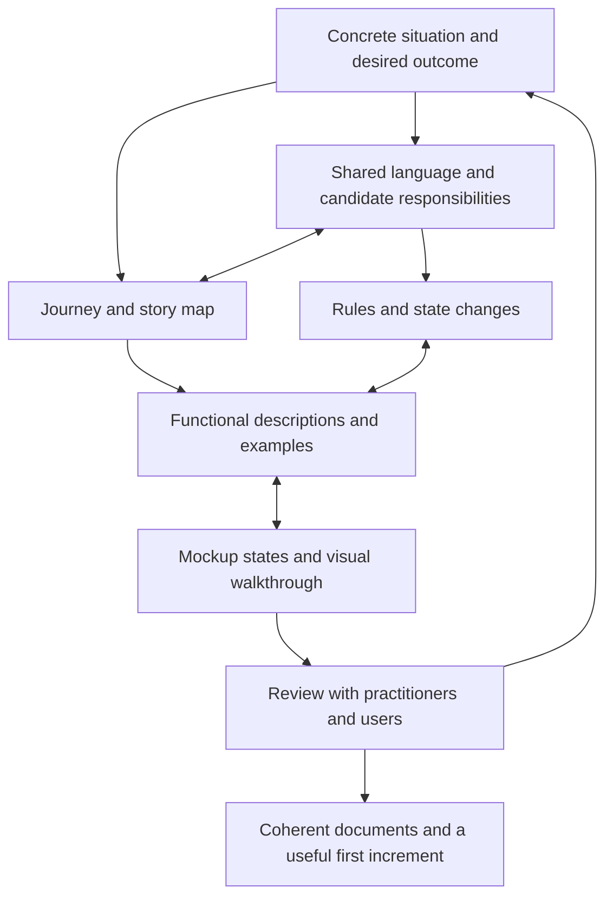

# A practical manual for designing understandable software

From domain understanding to journeys, stories, functional descriptions and visual flows.

Version 1.2 · 29 October 2026

This manual is for someone who has encountered domain-driven design but needs a practical way to start designing a product. It combines domain modelling, experience design, user story mapping and specification writing. Its purpose is to help people reach shared, reviewable decisions about what a product should do and why.

The method is an original synthesis informed by the Memento specifications and HTML mockups. Memento supplies a running example; its particular rules are examples, not universal design requirements. This is a learning document, not an additional authority over the product specifications.

## Working definition: a delivery slice

> **A slice is a bounded increment of working product behaviour that delivers one coherent, demonstrable outcome and can be verified and reviewed as a unit.**

**Authorship and status:** this working definition was proposed by Codex during the Memento design discussion and adopted as a project delivery convention. It combines end-to-end vertical delivery, user story mapping and verification/review criteria. The exact definition and five criteria below are this project's synthesis, not a quotation from a particular author or a formal DDD definition. DDD informs domain ownership and rules; it does not prescribe these criteria or the slice-to-OpenSpec workflow.

A slice has five parts:

1. **Actor and trigger:** who starts the workflow, and under what circumstances.
2. **Outcome:** something meaningful the actor can finish or obtain, with an observable completion condition.
3. **Complete path:** the interaction, application logic, domain rules and persistence needed for that outcome. A background or API workflow may have no dedicated screen.
4. **Applicable safeguards:** permission, consistency, concurrency, interruption and recovery behaviour needed from the outcome's first supported use.
5. **Evidence:** a runnable demonstration and meaningful checks showing that the selected scope works, followed by review at its declared boundary.

“Independently demonstrable” assumes that the slice's stated prerequisites already exist. It does not mean independently deployable or a complete release. Keep the scope small enough to implement, verify and review as one coherent unit; there is no fixed duration or number of stories.

For example, **record a human Decision supported by an exact Note revision, change the Note, and reopen the Decision's original evidence after restart** is a slice. Creating its tables, endpoint or dialog are implementation tasks within that slice. A slice may cross bounded contexts while respecting their ownership. A feature may require several slices, and a slice may require several OpenSpec changes.

### Compare the concepts

| Concept | What it organizes | Main question |
| --- | --- | --- |
| DDD | Domain language, model ownership, bounded contexts, aggregates and invariants. | What does the work mean, who owns each rule, and what must remain true? |
| Feature | A recognizable product capability or benefit. | What value should the product offer? |
| Delivery slice | One bounded, demonstrable increment of working behaviour. | What meaningful outcome can we implement, verify and review next? |
| OpenSpec change | A bounded proposed delta, its behavioural contracts, design and implementation tasks. | What exactly changes, and how will that authorized change be realized? |
| Implementation task | A technical step contributing to the change and outcome. | What work must be done to deliver it? |
| Release work package | Cross-cutting verification, deployment readiness or integrated acceptance work. | What evidence and operating preparation does the release still need? |

These concepts have many-to-many relationships. A screen is not automatically a bounded context, a feature is not automatically one slice, and a slice is not automatically one OpenSpec change. DDD is a modelling approach; the slice definition is the project's delivery convention.

Applied strictly, whole-release storage/deployment verification and the final acceptance rehearsal are release work packages rather than product slices: they establish readiness without necessarily introducing a new user outcome. SL-014 and SL-015 in the current [release plan](delivery/releases/v1.0/plan.md) are examples. Their existing identifiers and required work remain intact; the SL prefix alone does not establish that a record is a product slice.

### Compare the ways of proceeding

| Approach | When it helps | Application to Memento |
| --- | --- | --- |
| Define features, then create OpenSpec changes. | Product scope and capability grouping still need discovery. | Reuse the existing capabilities, journeys and stories; add feature definitions only where meaning is missing. |
| Go directly to an OpenSpec change. | A small, understood outcome has clear scope and prerequisites. | Suitable for the next ready, authorized slice or a focused correction. |
| Reason about the implementation sequence, then prepare changes progressively. | Several outcomes share foundations, domain contracts or integration risks. | The preferred overall approach: order outcome slices, explain dependencies and risks, and prepare the next change in detail. |

Keep the release direction visible while adding detail progressively. Use a walking skeleton for the smallest real entry-to-persistence-to-reopen path, an example workshop for ambiguous meaning, or a bounded experiment for a consequential technical uncertainty. These techniques support the planning loop. Creating a plan does not itself create an OpenSpec change or authorize implementation.

## How to use the manual

Start with the [slice definition](#working-definition-a-delivery-slice) and [concept comparison](#compare-the-concepts) above to distinguish modelling from delivery planning. Read sections 1–3 to understand the approach. Work through sections 4–13 with one real situation. Use sections 14–17 to assemble and review your documents. Section 18 explains what the Memento material demonstrates and where it needs caution. Section 19 provides reusable worksheets.

Do the first pass with a few people, plain text and rough sketches. A domain practitioner who knows the actual work, someone responsible for product decisions, a designer and an engineer provide useful complementary perspectives. One person can cover several responsibilities. If the practitioner is unavailable, label the model as a hypothesis and arrange a later review.

You are ready to begin when you can identify a person with a problem, obtain a concrete example of that problem and find someone who can clarify the rules. You do not need a complete domain model, a backlog or a chosen technology stack.

| Reading route | Sections |
| --- | --- |
| Understand delivery terms and choices | [Working slice definition](#working-definition-a-delivery-slice), [DDD/features/slices/changes](#compare-the-concepts), [ways of proceeding](#compare-the-ways-of-proceeding). |
| Understand the approach | [Useful design](#1-what-a-powerful-design-gives-its-readers), [perspectives](#2-understand-the-perspectives-before-creating-documents), [learning loop](#3-work-in-a-learning-loop). |
| Discover the work and its meaning | [Real situations](#4-begin-with-the-work-people-actually-do), [language](#5-build-shared-language-through-distinctions), [responsibilities](#6-find-responsibilities-and-candidate-bounded-contexts). |
| Describe what people accomplish | [Journeys](#7-describe-the-journey-from-trigger-to-outcome), [story mapping](#8-build-a-story-map-and-choose-a-useful-first-scope), [functional descriptions](#9-turn-stories-into-functional-descriptions). |
| Make the design concrete | [Domain rules and change](#10-deepen-the-domain-model-around-rules-and-change), [mockups](#11-design-mockups-as-a-sequence-of-visible-states), [engineering contracts](#12-add-engineering-contracts-where-the-promise-needs-them). |
| Review and write | [Reviews](#13-review-the-design-through-examples-and-counterexamples), [document structure](#14-assemble-a-readable-specification-set), [traceability](#15-keep-traceability-useful-and-proportionate), [sufficient detail](#16-decide-how-much-detail-is-enough). |
| Put it into practice | [Working sessions](#17-run-a-first-design-cycle), [Memento analysis](#18-what-the-memento-analysis-demonstrates), [worksheets](#19-reusable-worksheets). |

## 1. What a powerful design gives its readers

A useful design lets a reader answer five questions:

1. What is this person trying to accomplish, and why does it matter?
2. What do the important words mean in this situation?
3. What can happen, who may make it happen, and what must remain true?
4. How will the person recognize the state of the work and take the next step?
5. What examples would demonstrate that the design is correct and useful?

Precision comes from making consequential distinctions. In Memento, an editable Note, a suggested Proposal and a human Decision can look like similar cards, but they mean different things. Capturing an external task is different from changing that task. Approving an operation is different from establishing its outcome.

Those distinctions determine the vocabulary, records, permissions, controls, messages and recovery paths. A design becomes powerful when its different views consistently express them.

The documents are a record of this understanding. Writing them is part of the reasoning process: a difficult paragraph, ambiguous label or unexplainable arrow often exposes a decision that has not been made.

### Four kinds of statement

Keep these distinguishable while you work:

| Kind | Example | What to do with it |
| --- | --- | --- |
| Observation | “In the last briefing change, Maya copied the message into the planning document.” | Keep the source, date and circumstances. |
| Hypothesis | “People may need to compare the earlier and replacement decisions.” | Identify who or what could confirm it. |
| Design decision | “An accepted Decision will retain its original evidence.” | Record the rationale, decision owner and affected behaviour. |
| Validation result | “In this walkthrough, the participant found the earlier decision without help.” | Record the task, participant context and limits of the observation. |

A plausible design decision is still a decision. A polished prototype is still a prototype. Neither supplies missing evidence about how people currently work.

## 2. Understand the perspectives before creating documents

Domain-driven design gives you a language for meaning and responsibility. Experience design gives you a language for human activity. Story mapping helps organize useful increments. Functional descriptions make the behaviour explicit. Mockups make the interaction inspectable.

These perspectives answer different questions:

| Perspective | Main question | Typical output |
| --- | --- | --- |
| Product purpose | Whose situation should improve, and what improvement matters? | Outcomes, scope and success signals. |
| Domain | What concepts, rules and responsibilities make that improvement possible? | Language, context map, model and lifecycles. |
| Journey | How does a person reach an objective across time and handoffs? | An end-to-end narrative or journey table. |
| Story map | What activities and tasks make up the experience, and what is the smallest useful scope? | Ordered activities, tasks, stories and outcome cuts. |
| Functional behaviour | What happens when an actor makes a particular request? | Use cases, requirements and scenarios. |
| Visual interaction | How does a person perceive and operate that behaviour? | Storyboards, screen states and interaction contracts. |
| Engineering | What must make these promises reliable? | Integrity, security, integration and recovery contracts. |

A journey can cross several domain contexts. One screen can combine information from several owners. One domain rule can affect several stories. A story can require several screen states. A background workflow can have no dedicated screen.

Avoid forcing a one-to-one correspondence between these views. In particular, a screen is a presentation boundary; a bounded context is a boundary around a coherent model and its language.

### The small amount of DDD vocabulary you need

Within a bounded context, a ubiquitous language gives collaborators consistent terms. Entities retain identity through change; value objects express meaning through their values. Aggregates protect consistency through a controlled boundary. Commands request changes, queries retrieve information and domain events describe facts that happened. A context map makes relationships between models explicit. These concepts follow the foundations in [Eric Evans’s DDD Reference](https://www.domainlanguage.com/wp-content/uploads/2016/05/DDD_Reference_2015-03.pdf).

You will use these ideas to ask better questions. The practical worksheets below are based on the repository analysis and the worked example.

## 3. Work in a learning loop

Start with a real situation, sketch enough of each perspective to expose uncertainty, and revisit it as you learn.



The diagram describes relationships, not a rigid phase sequence. An early sketch may reveal a missing domain concept. A concurrency example may change an aggregate boundary. A practitioner may reject a journey because its handoff happens in a different order.

Keep a short question list beside the work. For each question record its consequence, who can resolve it and whether it blocks the next experiment. “What does approval authorize?” blocks action design. “Which icon represents history?” usually does not.

## 4. Begin with the work people actually do

### What to investigate

Ask someone to describe a recent real instance, using the messages, forms, spreadsheets or records involved. Follow what happened before discussing the proposed software.

Useful prompts include:

- What started this piece of work?
- What were you trying to achieve?
- What information did you need, and where did it come from?
- Who could make the decision? Who had to be informed?
- At what point did you consider the work finished?
- What was unclear, repeated, lost or risky?
- Show an exception: what happened when the normal route failed?
- What would have happened if two people had acted at the same time?

Ask to see examples that contradict the first account. A process described by its owner may differ from the work performed by a participant.

### Produce a short situation brief

Write the actor, trigger, objective, current difficulty, desired outcome and boundary. Describe current work separately from the proposed future.

**Running example — the briefing changes time**

> Maya coordinates a launch briefing. A speaker reports that 10:00 no longer works and requests 11:00. The launch date must remain unchanged. Maya and Leo need to assess the request, retain the reason for the changed time, confirm the room and notify the speaker. Later, someone should be able to recover what was agreed and why.

This is an authored Memento design example, not a claim about an observed customer interview. In a new project, obtain comparable situations from actual work.

The intended improvement might be: a returning colleague can establish the current briefing time and inspect the reason without reconstructing several conversations. Decide how to investigate that improvement. Possible signals include successful unaided retrieval, fewer conflicting interpretations or less time reconstructing a decision. Establish a baseline before choosing a numerical target.

### Define scope and authority

State what the product owns and what remains elsewhere. In the example, Memento owns the team’s recorded reasoning and captured evidence; the mailbox owns the native message and the task service owns the native task.

Write the exclusions that prevent misleading promises. For this example, importing evidence does not grant general mailbox access or establish continuous synchronization.

**Enough for this pass:** a practitioner can recognize the situation, explain why it matters and identify its unresolved assumptions. A feature list alone does not satisfy this check.

## 5. Build shared language through distinctions

### Start with words from the situation

Underline nouns such as message, proposal, decision, task, member and board. Circle verbs such as capture, review, record, approve, execute and replace. Ask what each means here.

Do not immediately turn nouns into classes. First find the distinctions people rely on:

- Is a request already a commitment?
- Does “approved” mean permission to proceed, or confirmation that work finished?
- Is the displayed task its live state or a captured observation?
- Does removing something from a view erase it?
- Is “owner” the person who created the record, the assignee or the person with administrative authority?

### Write a working glossary

Use a definition, a concrete example and a distinction. Add context and authority when the same term has several meanings.

| Term | Meaning in the example | Distinction that matters |
| --- | --- | --- |
| Note | Editable working text contributed by a participant. | Writing an idea does not record a Decision. |
| Proposal | A separately reviewable suggested option. | Adopting it creates working material; commitment is explicit. |
| Decision | A human-recorded chosen statement with reason and exact evidence. | It remains meaningful when its card is removed. |
| Source Observation | Captured external content at a particular time and revision. | It does not claim that the provider still has that state. |
| Action | A proposed external operation with reviewable content and destination. | It is separate from the native task it may create. |
| Approval | Authorization of an exact Action version and target. | It is neither execution nor proof of success. |
| Placement | A record’s representation and position on a board. | Geometry has a different lifecycle from content. |

Keep definitions short enough to use in conversation. If every definition needs several exceptions, the concept may contain multiple meanings.

### Run the replacement test

Take a sentence containing a vague word and replace it with the precise concept.

“The task is updated” could mean any of the following:

1. Someone changed the draft Action.
2. The native task service accepted an edit.
3. A participant captured a new observation.
4. A board representation now displays that observation.

These are different events with different authority and failure cases. Naming them reveals work that a generic “update” conceals.

**Enough for this pass:** participants can retell the example using the same words and agree on what each implies. Record remaining disagreements explicitly.

## 6. Find responsibilities and candidate bounded contexts

### Separate business areas from model boundaries

First identify areas of the problem: access, collaborative reasoning, visual arrangement, external evidence and follow-through. Discuss which area differentiates the product, which supports it and which is a common capability.

Then propose model boundaries. A subdomain describes an area of the problem; a bounded context identifies where a particular model and language apply. They need not have identical boundaries. A context also does not automatically require its own service or deployment.

### Use ownership questions

For each candidate area ask:

1. Which terms and rules belong together?
2. Who can authorize a change to these facts?
3. Which facts are authoritative here, and which are copied or summarized?
4. Which other area needs these facts, and in what form?
5. Where must external terminology be translated?

In Memento, Collaborative Knowledge owns Decisions and their meaning. Visual Collaboration owns Placements. Connected Work owns external captures and approved operations. Workspace and Access supplies identity and membership facts. Agent Participation owns the bounded assistance workflow. Home and Activity display information from these owners.

That is a particular product design. A simpler application may need fewer contexts; another may require different ones.

### Make a responsibility table and context map

| Candidate context | Owns | Consumes or publishes | Boundary example |
| --- | --- | --- | --- |
| Collaborative Knowledge | Notes, Proposals, Decisions and evidence references. | Publishes current and historical knowledge. | A Decision’s statement cannot change through a card drag. |
| Visual Collaboration | Board composition, Placements and visual links. | Consumes represented records; publishes arrangement. | Removing a Placement preserves its record. |
| Connected Work | Captures, Action review, Approvals and Outcomes. | Consumes a supporting Decision; translates provider results. | A timeout cannot be translated into confirmed failure. |

Draw arrows labelled with what crosses the boundary: “exact evidence reference,” “current authority,” “reviewed operation” or “captured outcome.” An unlabelled dependency says little about meaning.

For each important relationship, record who defines the contract, who can change it and who must adapt. External provider models often need a translation boundary so their statuses and identities do not silently redefine the product’s language. Where teams share ownership, record how they coordinate changes. Use formal context-relationship pattern names only when they clarify an actual relationship.

### Test the boundaries

Ask: “Could this responsibility change independently?” A board can change layout without changing a Decision’s meaning. That supports separate ownership. If a context needs to inspect and change another context’s private details for every request, revisit the boundary or make the collaboration contract clearer.

**Enough for this pass:** each important fact and rule has a candidate owner, and the main handoffs are named. Leave uncertain boundaries provisional until concrete scenarios test them.

## 7. Describe the journey from trigger to outcome

A journey follows a person pursuing a meaningful objective. Include work outside the application, waiting and handoffs. “Open the Inspector” is an interaction step. “Establish the new briefing time and retain its reason” is a journey objective.

### Write the narrative first

Use this order: actor and situation; trigger; desired outcome; main progression; alternatives; interruptions; completion condition.

For the running example:

> When a speaker requests 11:00, Maya brings the message into the shared workspace and compares it with the launch constraint and earlier agreement. She may discuss or adopt a suggested option. She explicitly records the new time and its reason, preserving the earlier agreement. She prepares room-confirmation work for Leo and reviews the exact task before authorizing it. After execution, she inspects the result. A returning colleague can find both the current direction and the earlier evidence.

The optional Proposal does not become a mandatory stage merely because it appears in the example.

### Expand the narrative into a journey table

| Stage | Actor’s objective and action | Information or authority needed | Visible result | Friction or alternate path |
| --- | --- | --- | --- | --- |
| Notice | Maya recognizes a request to change the time. | Speaker’s message and existing agreement. | The request is identifiable. | Message unavailable or irrelevant. |
| Understand | Compare request and constraints. | Exact captured message, fixed date, earlier Decision. | Relevant evidence can be inspected together. | Evidence is incomplete or contradictory. |
| Establish direction | Record the selected time and rationale. | Membership and valid evidence. | Current Decision and preserved predecessor. | Missing reason; another member replaced it first. |
| Prepare follow-up | Describe Leo’s room-confirmation task. | Current Decision and permitted task destination. | Reviewable draft. | Destination or required fields unavailable. |
| Authorize and act | Review, approve and explicitly execute. | Exact version, current authority and allowed capability. | Pending operation followed by an established Outcome. | Approval invalidated or submission uncertain. |
| Return | Recover the current position and why it changed. | Retained history and permitted access. | Navigable reason, evidence and result. | Record is no longer on the board. |

Add pain points and confidence where they inform a design decision. If you have no participant evidence, label a pain point as a hypothesis.

For a complex handoff, add lanes for each person, the product and external services. Use these to expose who is waiting for whom. Do not turn a journey into a catalogue of API calls.

**Enough for this pass:** someone can tell the whole story, including its end, without a screen tour. The narrative identifies consequential alternatives and interruptions.

## 8. Build a story map and choose a useful first scope

A story map organizes work around the user’s progression. Jeff Patton describes it as modelling the user’s story while discussing the journey, keeping activity and purpose visible. See his [story mapping resources](https://jpattonassociates.com/story-mapping/).

### Build the map in this order

1. Put broad activities across the top in a useful narrative order.
2. Under each activity, place the smaller tasks a person performs.
3. Add stories for different needs, alternatives and levels of support.
4. Arrange the most necessary stories higher within each task.
5. Draw a horizontal cut that supports a coherent outcome across the relevant activities.
6. Walk through that cut using a real example. Find missing prerequisites and handoffs.

Chronological order is a way to explain the experience, not a claim that all users always follow one sequence. Make loops and alternate routes visible when they matter.

### Worked map

This is a teaching map for the briefing problem, not a replacement for Memento’s release plan. Each increment includes applicable behaviour from earlier rows.

| Map level | Enter and resume | Understand context | Establish direction | Follow through | Recover the reason |
| --- | --- | --- | --- | --- | --- |
| User tasks | Find permitted work; open the discussion. | Read contributions; compare constraints and evidence. | State the choice; explain it; replace an earlier choice. | Prepare work; review it; establish its outcome. | Find the current choice; inspect history. |
| Increment A: retain a supported direction | One permitted workspace and board. | Write Notes and capture one selected message. | Record a Decision directly from evidence. | Describe follow-up as working text; external execution is deferred. | Reopen the Decision and its pinned evidence. |
| Increment B: perform reviewed task follow-up | Retain entry scope. | Retain evidence scope. | Require a current supporting Decision. | Draft, review, approve and execute one task; reconcile uncertainty. | Inspect the native identity and captured Outcome. |
| Increment C: broaden collaboration and choice | Add richer discovery and participation flows. | Add further source types and comparison paths. | Review optional Proposals and preserve supersession. | Add reviewed reply operations and dependencies. | Broaden search and history navigation. |

Increment A has an explicit boundary: it retains direction but does not promise external task execution. Increment B includes uncertainty recovery because a real submission can become uncertain on its first use. You can reduce the number of operation types; you cannot remove the rules that make the selected operation trustworthy.

The table is a readable summary. While discovering the scope, expand it into individual cards. For example, under the activity **Recover the reason**, separate these tasks and story cards:

| User task | Earlier story card | Later story card |
| --- | --- | --- |
| Inspect the basis for a choice. | As a returning member, inspect the exact evidence attached to a known Decision so I can understand its basis. | Compare the predecessor and successor so I can understand changed direction. |
| Find an earlier choice. | Reopen a known Decision from the board so I can resume its context. | Search retained records, including unplaced ones, so I can recover work no longer visible. |

Place each card under its task, then draw the chosen outcome cut across the whole map. Keep the benefit and relevant variants with the card. The “earlier/later” placement is a scope hypothesis to review against the chosen outcome, not an inherent priority of those needs.

### Distinguish stories from implementation tasks

“As a coordinator, I want to inspect the exact task before authorizing it, so that follow-up reflects the agreed work” describes a need.

“Create an endpoint” and “add a modal component” describe implementation work. They may be necessary, but they do not form the backbone of the user story map.

Split an oversized story by a useful variation: one actor, operation type, entry path, source type or bounded outcome. Preserve the relevant permission, consistency and recovery rules. A database-only increment may enable delivery but needs an explicit relationship to a demonstrable user outcome.

**Enough for this pass:** you can explain what the first cut lets someone finish, what it defers and how a later cut adds value. A row of priorities without activities and tasks is an incomplete story map.

## 9. Turn stories into functional descriptions

A story expresses a need and its value. A functional description explains the interaction that satisfies it. A requirement states a behaviour the product promises. Scenarios make that promise concrete.

These can live together in a small document. Separate files are useful only when they improve ownership or readability.

### Write a story with a meaningful benefit

> As a workspace member responsible for follow-up, I want to review the exact task and destination before authorizing it, so that the task created for Leo matches our recorded decision.

The benefit explains a consequence. “So that I can use the feature” does not help decide its design.

### Worked functional description: approve and execute a task

**Purpose:** carry an agreed follow-up into the task service under explicit human authority.

**Primary actor:** an authorized workspace member.

**Trigger:** the member requests review of a prepared task Action.

**Preconditions:** the Action has a reviewable current version, a current supporting Decision and a permitted configured destination. Approval and execution each recheck the relevant authority and state.

**Information shown:** operation type, task title/content, assignee, due date, destination, supporting Decision, Action version and current approval validity. These fields define the review; they are not a database schema.

**Main interaction:**

1. The member opens the Action’s review.
2. The product presents the complete proposed operation and identifies that nothing has been submitted.
3. The member approves the exact version shown.
4. The product records that Approval and makes the next permitted action clear.
5. The member explicitly requests execution.
6. The product rechecks approval, authority, target, supporting Decision and applicable prerequisites.
7. The operation becomes visibly pending while the external service is contacted.
8. When the required result is established, the product records the Outcome and native task identity.
9. The member can inspect the result and open the independent task client, subject to that client’s access rules.

**Alternatives and exceptions:**

- Cancel review: no Approval or submission is created.
- Revise the draft: the changed version requires a new review and Approval.
- Lose authority before dispatch: block the operation and explain the applicable next step.
- Fail before any external submission: retain the draft and report the known failure.
- Lose the response after submission: preserve uncertainty and offer outcome inspection/reconciliation; do not invite a blind repeat.
- Repeat a request: resolve the same intent without inventing another accepted operation.

**Success postcondition:** an inspectable Outcome establishes the required task result for the reviewed operation.

**Minimum retained state on interruption:** the draft, relevant approval history and any admitted attempt remain identifiable; an unknown result is not presented as success or confirmed failure.

**Linked rules:** exact-version Approval; current scoped authority; distinguish submission from success; resolve uncertainty before repeating.

This description is sufficiently concrete for someone to sketch the interaction, identify domain commands and challenge its exceptions. It does not require a transport protocol or UI library choice.

### Write observable requirements

Use actor or scope, condition, behaviour and result. Include the qualification that matters.

| Weak statement | More useful statement |
| --- | --- |
| “Support approval.” | “Before dispatch, the product checks that a human Approval still matches the Action version and permitted target.” |
| “Keep history.” | “Replacing a Decision preserves the earlier statement, rationale and exact evidence for authorized inspection.” |
| “Synchronize tasks.” | “Only an explicit refresh introduces a newer captured task observation for the addressed reference.” |
| “Handle errors.” | “After an incompatible edit is rejected, the member can inspect accepted text and recover the local draft.” |

Separate promises with independently meaningful conditions or outcomes. A short summary requirement can have several clauses, but its detailed scenarios should make each consequential behaviour reviewable.

### Add concrete scenarios

For a behaviour with consequential changes, examine normal, denied, concurrent and interrupted/recovery cases. Use only the categories that can occur, and add more examples where the risk warrants them.

**Normal**

> Given Maya has approved task Action version 3 for Leo in the Atlas task collection, and its prerequisites have succeeded, when she requests execution, then the required task is established with the reviewed fields and its native identity is recorded.

**Denied**

> Given version 3 was approved and the assignee is changed in version 4, when execution is requested, then no submission is admitted under the old Approval and a new review is required.

**Concurrent**

> Given Maya reviews version 3 while Leo saves version 4, when Maya submits approval for version 3, then it cannot authorize version 4; the product presents the current version for review.

**Interrupted and recovered**

> Given the task service accepted the operation but its response was lost, when the member inspects the Action, then it remains uncertain until evidence establishes the original result; finding that task records success without creating another task.

Use concrete versions and actors where they expose ambiguity. Expected outcomes must say what can be observed and what remains preserved. “The system handles this correctly” is not an expected outcome.

**Enough for this pass:** a reader can predict the result of normal and consequential exceptional requests without inventing policy. A single success example is insufficient for a workflow that changes authority, evidence or external state.

## 10. Deepen the domain model around rules and change

Now use the journeys and functional descriptions to refine the candidate model. This is where tactical DDD becomes practical.

### Identify identity, value and history

Ask what remains the same thing through change. An Action retains identity as its draft is revised and reviewed. An exact reviewed payload is a value describing one version. A native task created from that Action has a different identity and owner.

Ask what must remain inspectable. The current Note can be editable while a cited revision remains preserved. A source’s stable identity can coexist with several immutable observations. A representation can disappear while the represented record survives.

Write the few fields needed to explain these distinctions. Defer storage columns and serialization details.

### Derive invariants

An invariant states what valid committed state must preserve. Start by asking, “What would be an unacceptable outcome even if every individual form looked valid?”

Examples from Memento include:

- An Approval cannot authorize a different Action version or target.
- A Decision’s cited evidence cannot silently become newer content.
- A workspace cannot lose its last active Owner through membership changes.
- Drawing an arrow cannot establish an execution prerequisite.
- Removing a Placement cannot erase cited knowledge.

Record the rule, its rationale, owner, affected operations and counterexamples. Reference it from stories rather than copying slightly different versions into each one.

### Find aggregate boundaries by testing consistency

Take one rule and ask which state must be checked and changed together. For an Action, payload version and approval validity must remain consistent when content changes. That makes the Action and its approval validity a candidate aggregate responsibility.

Then test competing requests. If one request approves an old version while another edits the payload, can both produce a valid result? If the design permits an Approval to authorize unreviewed content, the consistency boundary is incomplete.

Do not pull every related object into that aggregate. The supporting Decision, membership and connection have other owners. Record which of their revisions or authority facts the application operation must protect and revalidate. A cross-aggregate rule requires an explicit coordination strategy; drawing a larger box does not settle it.

Start with the smallest boundary that protects the rule and can be explained using real operations. An aggregate is not automatically a database table, a complete board, or all information visible on one screen.

### Describe commands, queries and facts

| Kind | Example | Question to settle |
| --- | --- | --- |
| Command | Approve Action. | Who may request it, for which version, and in what state? |
| Command | Execute Approved Action. | What must be rechecked before dispatch? |
| Query | Review Action. | Which exact operation and validity information are returned? |
| Fact/event | Action Approved. | What committed change occurred, by whom and for which version? |
| Fact/event | Action Outcome Uncertain. | What is known, and what remains unresolved? |

An event name in past tense should correspond to something established. Clicking Save does not justify “Decision Recorded” if the operation was rejected. The model can use events without selecting an event-sourced architecture.

### Make lifecycle transitions explicit

The following is a simplified teaching view of the Action lifecycle. The [Memento Domain Specification](specs/memento-domain-spec.md#72-actions-approvals-and-outcomes) contains the fuller state model.

| Current state | Request or fact | Next state | Guard or consequence |
| --- | --- | --- | --- |
| Awaiting approval | Approve exact version. | Approved | Authorized human and current reviewed version. |
| Approved | Change relevant reviewed content. | Awaiting approval | Prior Approval no longer authorizes the operation. |
| Approved | Explicit execute passes checks. | Queued | Current authority, target and prerequisites. |
| Queued | Dispatch admitted. | In execution | Final applicable checks pass. |
| In execution | Required provider result established. | Succeeded | Retain actual result evidence. |
| In execution | Response/result cannot be established. | Uncertain | Do not infer confirmed failure. |
| Uncertain | Original result found. | Succeeded | Record it without resubmission. |
| Uncertain | Original operation confirmed absent. | Awaiting approval | Clear Approval; renewed review precedes another attempt. |
| Uncertain | Evidence remains inconclusive. | Uncertain | Preserve the inspect/reconcile path. |

Also identify invalid transitions and explain them. An invalid transition is part of the functional design, because someone will eventually attempt it through stale UI, repeated input or a concurrent action.

**Enough for this pass:** each high-consequence operation has an owner, preconditions, relevant state transition, protected rule and meaningful rejected result. You can tell the story without describing database joins.

## 11. Design mockups as a sequence of visible states

Begin with rough states and representative content. Increase fidelity after the important distinctions and paths hold together. A populated example helps expose information density, but it should be paired with starting and recovery states.

### Create a storyboard before polishing screens

For each frame write: situation, information shown, available action, resulting change and next state. Several frames may use the same screen.

| Frame | What the person sees | What they can do | Meaning that must survive the interaction |
| --- | --- | --- | --- |
| 1. Find work | Permitted workspace, recognisable preview and recent activity. | Open the relevant board. | A preview represents actual accessible material. |
| 2. Inspect context | Message capture, capture time, constraint and earlier Decision. | Read details or deliberately request refresh. | Reading and refreshing are separate. |
| 3. Record direction | Chosen statement, rationale and selected evidence. | Save or cancel; correct missing information. | A new human Decision is explicit. |
| 4. Inspect current direction | Current Decision, predecessor and pinned evidence. | Prepare follow-up or inspect history. | Unrelated Decisions can remain current. |
| 5. Review task | Exact fields, destination, version and unsubmitted state. | Revise, cancel or approve that version. | Approval refers to the operation shown. |
| 6. Approved task | Approval validity and available execution request. | Explicitly execute. | Approval and execution remain distinguishable. |
| 7. Uncertain outcome | What was submitted, what is known and what is unknown. | Inspect or reconcile. | The interface does not suggest a blind repeat. |
| 8. Return to history | Decision, captured evidence and established Outcome. | Inspect exact evidence; locate a current card. | History remains usable without restoring a Placement. |

Sketch alternatives beside the main sequence. At frame 3, show missing rationale and concurrent replacement. At frame 5, show a stale review. At frame 7, show both “result found” and “still unknown.”

### Give every significant screen a state inventory

Consider initial/empty, loading, draft, validation error, pending commitment, success, denied access, conflict, interruption and recovery. Some states can share a visual treatment; their meaning must remain clear.

For each applicable state settle:

- What does the person know at this point?
- What has actually committed, and what remains local or pending?
- What can they do next?
- What is preserved if they leave, cancel or retry?
- Where will focus and navigation return?

You do not need a separate polished screenshot for every state. A small sketch with exact copy and an interaction annotation can communicate it well.

### Translate model distinctions into visual grammar

Memento offers useful examples:

| Domain distinction | Visual consequence |
| --- | --- |
| Note versus Decision | A freeform Note remains editable and has no commitment-state badge; a Decision identifies its state and rationale. |
| Information versus command | Reference cards lead to inspection; explicit action buttons request a change. |
| Current versus superseded | Both remain readable, with labels and distinguishable boundaries. |
| Content versus Placement | “Remove from board” explains its limited effect; retained material remains inspectable. |
| Exact evidence versus current record | References identify the captured revision rather than displaying an unexplained “latest.” |
| Approval versus execution | Review/approve and execute are separately understandable actions. |

Use words as well as colour. Keep a consistent meaning for controls and statuses across screens. Place consequential actions close to the context they affect and make their scope readable before activation.

Presentation choices also need direct examination: long text, realistic content, empty boards, narrow layouts, keyboard use, zoom, focus, contrast and touch. Domain correctness cannot tell you whether a participant can find a button or read a dense card.

### Write the interaction contract beside the mockup

For freeform editing, specify how editing begins, what Enter does, how saving/cancelling works, what counts as acceptance and what happens on conflict. For a dialog, specify its field meanings, validation, action labels, focus, cancellation and next state.

This is where visual and functional descriptions meet. “Save” needs a known effect. “Refresh” needs a known target. “Undo” needs a defined boundary.

**Enough for this pass:** a reviewer can walk a meaningful task from entry to result and recover from its important interruption. Every consequential control has an explained effect, including controls the prototype only simulates.

## 12. Add engineering contracts where the promise needs them

Once the behaviour is clear, ask what can prevent the product from keeping it. Keep the human consequence visible when documenting the answer.

| Behavioural promise | Engineering question | Contract to settle |
| --- | --- | --- |
| Accepted text is retained. | What if two people save the same base version? | Acknowledgement, conflict handling and draft recovery. |
| A Decision retains its evidence. | What if the original text changes or disappears? | Exact reference identity and retained historical content. |
| Only permitted members see the board. | What if access is revoked during an open session? | Current authorization on queries, changes and subscriptions. |
| The reviewed Action is the one executed. | What if payload or authority changes after review? | Version-bound Approval and protected dispatch checks. |
| Retry does not create another task. | What if the provider acted but the response was lost? | Durable operation identity and outcome reconciliation. |
| Returning work survives restart. | What if the process stops after commitment? | Persistence, recoverable work and restart semantics. |

Avoid “fast,” “secure,” “reliable” or “accessible” as complete requirements. Define the affected workflow, condition, observable target and how it will be checked. Mark initial numerical budgets as targets until measured.

For integrations, record field meaning, source identity, authority, timestamp meaning, available capabilities and failure interpretation. A provider’s “owner” field may not mean task assignee. A successful first call may not establish a complete multi-step operation.

Keep platform selection separate from these promises. A technology decision should cite the contract it serves, constraints, tradeoffs and evidence still needed. Choosing a library does not decide whether a card is a Decision or whether a timeout permits retry.

**Enough for this pass:** engineering can identify the mechanisms to investigate without choosing product policy on the reader’s behalf. Unresolved technical choices have bounded questions and owners.

## 13. Review the design through examples and counterexamples

Use three complementary reviews.

### Domain review

Retell the example with a practitioner. Ask whether the words, authority and rules match the work. Introduce counterexamples: two Owners leave together; two people replace the same Decision; the approved target changes; the provider is unavailable.

Change the model when the explanation breaks down. Keep the rationale for consequential choices so a later reader knows why a distinction exists.

### Experience review

Give a representative participant a goal and starting situation. Ask them to work through the mockup and explain what they think is happening. Avoid telling them which control to use.

Useful tasks include “Find why the briefing moved,” “Prepare this task without sending it,” and “Establish what happened after this interrupted send.” Observe whether they distinguish a suggestion, a commitment and a confirmed result.

Record hesitation, mistaken interpretation, missing information and recovery. Separate observed behaviour from your interpretation of its cause. One successful walkthrough does not establish broad usability.

### Coherence review

Pick a behaviour and trace it through all representations. Ask whether the story, requirement, rule, state model, mockup and verification example agree.

| Situation to challenge | Question |
| --- | --- |
| A button performs an extra operation. | Is that operation authorized and specified? |
| A state exists only in prose. | Can the person recognize and recover from it? |
| The same word has conflicting meanings. | Is the context explicit, or should the terms change? |
| A provider updates its record. | Which captures or views may change, and only after what request? |
| A prototype control stops at a notification. | Is the target transition documented and its prototype limit visible? |
| A story has only a success scenario. | What happens on denial, stale state or interruption? |
| Two documents repeat the rule differently. | Which owns it, and where should the other link? |

Treat documentation review, prototype walkthrough, implemented verification and stakeholder acceptance as separate results. Keep actual checks and acceptance records distinct from target requirements.

## 14. Assemble a readable specification set

You can begin in one document. Split it when audiences, ownership or change frequency justify the separation. Memento’s five-document structure is useful because each view has a clear purpose; five is not a required document count.

### Suggested structure

| Document or section | Recommended contents | Reader should leave knowing |
| --- | --- | --- |
| Product definition | Situation, outcomes, actors, scope, language, high-level responsibilities, product policies and success criteria. | What is being designed and why. |
| Experience and functional description | Journeys, story map, selected stories, use cases, requirements, scenarios and visible interaction contracts. | How people accomplish their work. |
| Domain model | Context responsibilities, concepts, identities, relationships, invariants, lifecycles and published operations. | What the product’s facts mean and how they may change. |
| Engineering contracts | Authorization, consistency, persistence, integration, performance, operation and recovery. | How behavioural promises remain reliable. |
| Platform decisions | Selected technologies, boundaries, constraints, rationale and unresolved implementation choices. | What is selected to realize those contracts. |
| Mockup set | Linked entry paths, representative content, state sequences, interaction annotations and known simulation limits. | What the experience looks and feels like. |

Start each substantial document with its purpose, what it owns, what it references and its review status. Use a short reading path. Explain terms before relying on them. Put the narrative before dense catalogues.

### Write for a human reader

Prefer “Changing the draft clears its Approval” to “Approval validity shall be dynamically recalculated according to relevant mutability conditions.” Precise words usually reduce the need for elaborate formal phrasing.

Use tables for comparable definitions and contracts. Use prose for purpose, rationale and journeys. Use diagrams for ownership, lifecycles and flow when the relationships are easier to inspect visually. Explain arrows and state guards in words.

Give examples immediately after rules that are easy to misread. Define mandatory, optional and deferred behaviour explicitly. Avoid presenting a future choice as already settled.

## 15. Keep traceability useful and proportionate

Stable identifiers help readers connect related statements as documents evolve. Add them when those statements are referenced; do not assign an identifier to every sentence.

Trace the need and the rule through their relevant views:

> Outcome → journey and story → functional behaviour and scenarios → domain responsibility/rules → visible states and engineering contracts → validation evidence.

This is a navigation pattern. The relationships can be many-to-many, and the authoritative statement should have one home.

### Real Memento example

| View | Existing reference | Contribution |
| --- | --- | --- |
| Journey | UJ-05, Follow through. | The end-to-end objective. |
| Story/requirement | US-32 / R-32. | Only the reviewed operation may execute under current authority. |
| Scenarios | S-32a / S-32b. | Valid execution and invalidated/unauthorized execution examples. |
| Domain | CW-07 / CW-08 and DR-09. | Approval, execution and the exact-authorization invariant. |
| Visual | Board Action → Review operation → Approve exact version → explicit execution. | The visible review boundary and next action. |
| Verification | AC-08, with AC-09 or AC-11 for actual native results. | Approval binding and the established external outcome. |

The [Experience](specs/memento-experience-spec.md#us-32---approve-and-execute-the-reviewed-version), [Domain](specs/memento-domain-spec.md#72-actions-approvals-and-outcomes) and [Technical](specs/memento-technical-spec.md#8-acceptance-criteria-and-verification) documents own these definitions. The manual explains their relationship.

### Change one meaning coherently

Suppose the product changes from captured evidence to live external monitoring. That is a change of meaning, not a label edit. Revisit policy, source identity/history, journey expectations, refresh controls, freshness messages, integration contracts and verification examples.

For an ordinary change, record the decision and rationale, update the owning definition, find its dependants, update affected mockups/examples and review the resulting whole. Preserve historical results as dated evidence. Check local links and any derived exports after files move.

## 16. Decide how much detail is enough

Detail should follow uncertainty and consequence.

| Situation | Useful first-pass depth |
| --- | --- |
| Simple reversible personal preference | Clear meaning, owner, interaction, persistence expectation and a few examples. |
| Shared editable content | Add identity, revision ownership, conflicts and recovery. |
| Access or membership change | Add authority, revocation, simultaneous-change rules and disclosure boundaries. |
| Historical evidence or commitment | Add exact identity, immutability/correction policy and retained inspection. |
| External operation | Add exact authorization, dispatch boundary, attempts, partial results and uncertainty recovery. |

You can stop refining the next selected outcome when:

- Its purpose and scope are understandable.
- Its important terms and owners are agreed or clearly provisional.
- Its actor, authority, preconditions and completion condition are explicit.
- Its consequential rules and state transitions survive realistic counterexamples.
- Its normal and important exceptional paths are inspectable in text and sketches.
- Its unresolved questions are bounded and do not silently delegate product policy.
- A practitioner, designer and engineer can independently tell compatible versions of the same story.

Later scope can remain less detailed. Do not write elaborate models for deferred capabilities whose need is untested. Equally, do not defer uncertainty recovery for an operation already allowed to submit work externally.

## 17. Run a first design cycle

The following is a suggested facilitation plan, not a delivery estimate. Split sessions as needed and allow time to obtain real evidence between them.

| Session | Suggested focus | Tangible result |
| --- | --- | --- |
| 1: understand, 60–90 minutes | Examine one real case and an exception; agree outcome and boundary. | Situation brief, sources and question list. |
| 2: model, 60–90 minutes | Resolve vocabulary; propose responsibilities; test the important rules. | Glossary, candidate context map and invariant list. |
| 3: experience, 60–90 minutes | Tell the journey; map activities/tasks; cut a useful outcome. | Journey, story map and selected scope. |
| 4: specify and sketch, 90–120 minutes | Expand one consequential story; write exceptions and sketch states. | Functional description, scenarios and storyboard. |
| 5: challenge and consolidate, 60–90 minutes | Review with a practitioner and representative users; reconcile contradictions. | Revised documents, observed findings and open decisions. |

At the start of each session, retell the example. At the end, record what changed in your understanding and what evidence is still needed. Revisit earlier outputs when new information contradicts them.

Common mistakes and corrections:

| Mistake | Correction |
| --- | --- |
| Starting with a navigation menu. | Start with a person, trigger and outcome; derive navigation from real tasks. |
| Extracting classes from nouns immediately. | First settle meaning, identity, responsibility and rules. |
| Treating each screen as a bounded context. | Identify model ownership; let screens compose authorized information. |
| Treating stories as complete specifications. | Add the use case, rules and consequential examples. |
| Treating the story map as a release spreadsheet. | Preserve activities, tasks and the user’s progression. |
| Modelling every concept as a lifecycle stage. | Check whether it is a separate record, optional path or independent concern. |
| Polishing a populated dashboard only. | Walk from an empty starting point through a result and recovery. |
| Hiding uncertainty behind an error toast. | Explain known state, preserved work and safe next action. |
| Copying rules into every document. | Keep one owning definition and trace its effects. |
| Confusing simulated success with a fulfilled promise. | Label the simulation and record the verification still required. |

### From design to rolling delivery

Use the [working slice definition and comparison](#working-definition-a-delivery-slice) at the beginning of this manual as the delivery vocabulary. Once a coherent target exists, use its story map and domain responsibilities to choose the next demonstrable outcome. Record hard prerequisites, scheduling preferences and consequential uncertainties separately in the release plan. Explain each hard dependency through the command, record, authority or consistency guarantee it provides. Keep later scope at outline level and deepen the next selected slice around normal, denied, concurrent and interrupted examples.

The working loop is design/model and mockup walkthrough -> ordered outcome slice -> authorized OpenSpec change -> implementation and verification -> review and revised sequence. Features communicate value, contexts own meaning, slices demonstrate outcomes and changes package bounded deltas; these are many-to-many relationships. A short domain workshop can settle unclear meaning, while a bounded experiment can resolve an engineering risk before it dictates the plan. A walking skeleton establishes the smallest real entry-to-persistence-to-reopen path.

Memento's [release plan](delivery/releases/v1.0/plan.md) now brings direct human Decisions with pinned Note evidence forward in SL-016 and the complete reviewed task operation forward in SL-017. Its broader participation, editor and agent paths extend those earlier outcomes. The [guide](Design%20and%20Implementation%20Guide.md#8-openspec-foundation-and-authority-transition) owns preparation readiness and requirement migration: keep existing R/S definitions in Experience until an explicitly authorized migration preserves their IDs and replaces moved definitions with links. The planning revision creates no OpenSpec change and establishes no implementation or human acceptance.

## 18. What the Memento analysis demonstrates

### Basis and limits of this analysis

The analysis used the current Product, Experience, Domain, Technical and Platform sources, the repository design guide, current release plan and recorded documentation evidence. It examined the mockup HTML and active scripts, including the staged board-demo source and the historical discrepancy register. It also visually inspected all five rendered screens in desktop Chrome and followed representative navigation and board inspection paths on 29 October 2026.

The visual sample covered Access → demo entry → Home, Home → Templates, navigation to Activity, Home → the Atlas board, the selected Decision’s Inspector, Traceability and exact Action review. The sampled Activity context action displayed a notification. Review stopped before approving or executing the sample Action. The staged playback, all exceptional states, mobile layouts and keyboard journeys were not exhaustively exercised for this manual.

This establishes an analysis of authored design and sampled prototype interaction. It does not establish product implementation, real integration, usability across the target population or human product acceptance. The release plan describes application slices as planned. Existing documentation-check evidence is dated and has a narrower scope.

### How domain-driven design appears in the documents

The [Product Specification](specs/memento-spec.md) establishes shared language, strategic responsibilities and product policy. Its most useful modelling contribution is the separation of concepts that an undifferentiated “card” model would merge: content/Placement, Proposal/Decision, Source Record/Observation and Action/Approval/Outcome.

The [Domain Specification](specs/memento-domain-spec.md) carries these distinctions into identity, revision ownership, aggregate responsibilities, typed relationships, lifecycles and named commands. Its cross-context concurrency examples test whether the ownership model can preserve the stated rules. The five contexts are responsibilities inside one application; they do not imply five services.

The [Experience Specification](specs/memento-experience-spec.md) supplies the human view: 13 journeys, 36 stories and requirements, and 72 labelled scenarios. Those counts describe the authored catalogue, not coverage proven by execution. Its trace references connect observable behaviour to use cases, rules and verification targets.

The [Technical](specs/memento-technical-spec.md) and [Platform](specs/memento-platform-spec.md) sources distinguish engineering promises from technology selection. The [release plan](delivery/releases/v1.0/plan.md) keeps scheduling and actual evidence separate from those target contracts.

### How the mockups demonstrate visual flow

| Mockup | Design contribution | Method to reuse |
| --- | --- | --- |
| [Access](mockups/01-access.html) | Separate account and invitation entry with scope cues. | Make participation routes and resulting authority understandable. |
| [Home](mockups/02-home.html) | Workspace discovery, previews, recent/favourite return paths and starting options. | Design both starting work and resuming it. |
| [Templates](mockups/04-templates.html) | A structure preview before starting a workspace. | Show the consequence of a starting choice before commitment. |
| [Board](mockups/05-board.html) | Spatial working material, contextual operations, exact evidence and reviewable actions. | Keep meaningful commands near their affected context. |
| [Activity](mockups/03-activity.html) | Actor, event, time, outcome and contextual entry points. | Design the return journey and recovery of meaning. |
| Board Inspector and Traceability | Current/superseded records, pinned references and information distinct from commands. | Make history and model distinctions inspectable. |
| [Staged board demo source](mockups/board-demo.js) | A sequence from an empty board through contributions, direction, follow-up and recovery. | Explain change over time, with simulation limits visible. |

The visual flow goes beyond page-to-page navigation. On the board, the meaningful progression often occurs through selection, an Inspector state, a modal and a changed lifecycle state while the surrounding composition stays visible. The manual’s storyboard method captures this more accurately than a site map alone.

### What to strengthen when using it as a teaching example

1. **Show discovery as well as its result.** The inspected set contains a developed target design. It does not by itself demonstrate how user research established its outcomes or whether people find the design useful. A new project should keep interview evidence, alternatives, assumptions and observed walkthrough results.
2. **Expand the story-map hierarchy.** Memento’s map is a compact activity-by-phase coverage table, with tasks described separately. A beginner benefits from seeing activities, tasks and individual story cards together before compressing the result into a document table.
3. **Unpack compound scenarios.** Several labelled scenarios combine multiple conditions or operations. For example, S-21a describes both passive revisit/reconnect and an explicit refresh. Keep the narrative, but separate examples when different conditions require independently assessable results. Two labels per story are a catalogue convention, not a sufficiency rule.
4. **Test vocabulary against actual practice.** The model is internally explicit, but internal consistency alone cannot establish whether its distinctions fit users’ work. Review the terms with practitioners and test the labels in tasks.
5. **Resolve visual contradictions visibly.** The static-evidence policy supersedes remaining “sync” copy and the automatic-arrival checkbox in the mockup. The [historical comparison](specs/research/comparison-mockup-versus-spec.md) records the discrepancy and resolutions. A teaching walkthrough should identify such contradictions at the point of use.
6. **Separate a target path from a prototype shortcut.** The sampled global Activity “View context” action ended in a notification. The Experience target requires navigation to the actual record. A reviewer needs to know which transitions are demonstrated and which remain described.
7. **Preserve the full interaction model.** The realistic populated board is valuable, but empty, denied, concurrent and interrupted states need their own walkthroughs. The regression sources describe broader checks; this manual does not claim to have rerun them.
8. **Maintain the document navigation.** The original analysis found that the comparison had moved to `specs/research/` while Product and the verifier still addressed its earlier location. The subsequent planning revision repairs active references. Moving evidence requires checking incoming and outgoing links as well as the validation tool; historical evidence should retain its original dated scope.

The transferable achievement is a coherent set of complementary views. The transferable discipline is to challenge that coherence with real people, real examples and the important failure cases.

## 19. Reusable worksheets

Use these as prompts. Omit fields that add no useful information, and expand those whose uncertainty affects the design.

### A. Situation and outcome

```text
Situation / concrete example:
Source and date:
Current practice:
Primary actor and other participants:
Trigger:
Desired outcome:
Current difficulty and supporting evidence:
Proposed improvement:
How improvement will be investigated or measured:
Product responsibility:
External responsibility:
In scope / deferred:
Assumptions and unresolved questions:
Decision owner and review status:
```

### B. Vocabulary and responsibility

```text
Term and applicable context:
Definition in ordinary language:
Example:
Common confusion / distinction:
Identity and history, if relevant:
Who owns its meaning and may authorize changes:
Related terms:
Question or disagreement still open:
```

### C. Journey and map

```text
Actor and starting situation:
Trigger and end-to-end objective:
Stages in narrative order:
For each stage: task, information, authority, result, friction:
Handoffs and waiting:
Alternative route:
Interruption and recovery:
Completion condition:
Story-map activity / tasks / candidate stories:
Smallest useful outcome cut:
What that cut explicitly defers:
```

### D. Story and functional behaviour

```text
Story: As [actor], I want [capability], so that [meaningful benefit].
Journey / activity / task:
Trigger:
Preconditions and current authority:
Inputs and information shown:
Main actor/product interaction:
Alternatives:
Denied requests:
Concurrent changes:
Interruption, repetition and recovery:
Successful result:
What remains preserved on failure:
Observable requirement(s):
Concrete scenarios and expected outcomes:
Owning domain operations and rule references:
Relevant mockup states:
Open questions and owner:
```

### E. Domain rule and lifecycle

```text
Rule identifier and plain-language statement:
Why the rule exists:
Owning context and responsible concept:
Valid and invalid examples:
Affected commands:
Who may request them:
Required state/revision/authority:
What must be checked and changed consistently:
Facts produced on success:
Rejected outcome and preserved state:
Cross-context facts and coordination required:
Lifecycle transition(s): from / request or fact / guard / to:
```

### F. Mockup state and review record

```text
Journey, story and state name:
Starting condition:
Representative content and its meaning:
What is current, historical, draft, pending or uncertain:
Available actions and their exact effect:
Unavailable actions and explanation:
Validation, conflict and recovery:
Navigation, focus and return destination:
Simulation or missing transition:
Review task and participant context:
Observed result:
Interpretation, uncertainty and required revision:
Evidence, date and review status:
```

## Further reading and source navigation

For DDD terminology, use [Eric Evans’s Domain-Driven Design Reference](https://www.domainlanguage.com/wp-content/uploads/2016/05/DDD_Reference_2015-03.pdf). For the story-mapping practice, use [Jeff Patton’s story mapping resources](https://jpattonassociates.com/story-mapping/). The sequence, worksheets and Memento examples in this manual are a practical synthesis, not a prescribed process attributed to either author.

Repository starting points: [Product](specs/memento-spec.md), [Experience](specs/memento-experience-spec.md), [Domain](specs/memento-domain-spec.md), [Technical](specs/memento-technical-spec.md), [Platform](specs/memento-platform-spec.md), [mockup entry](mockups/index.html) and [historical comparison](specs/research/comparison-mockup-versus-spec.md).
